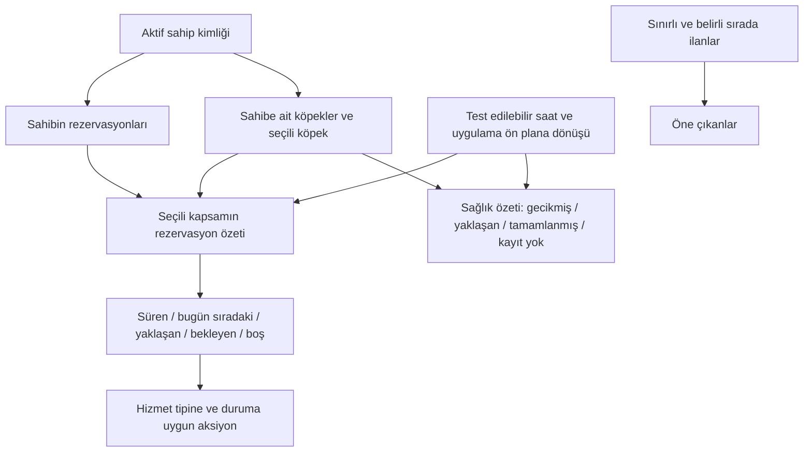

# PawCare — Yeni Kapsamlı Kod ve Davranış Denetimi

Denetim tarihi: **25 Ekim 2026**. Bu belge, önceki denetim listesi temizlendikten sonra mevcut kaynak kodu üzerinden hazırlanmıştır. Aşağıdaki kutular **uygulanacak işleri** gösterir; bulgunun doğrulanmış olması, çözümün yapılmış olduğu anlamına gelmez.

**Toplam 50 madde: 47 tamamlandı, 3 açık.** Başlangıç öncelik dağılımı: 20 P1, 28 P2, 2 P3. Liste; doğrulanmış davranış hataları, kaynak kodunda görülen ölçekleme/yaşam döngüsü riskleri ve açıkça işaretlenmiş ürün/platform kararlarını içerir. Elli maddenin tamamı cihazda üretilmiş hata olarak sunulmamaktadır.

**Okuma notu:** Her maddenin Kanıt/Etkisi bölümü ilk denetimdeki davranışı anlatır. Kapatılmış kutuların güncel çözüm ve kalıcı test kanıtı aşağıdaki uygulama adımlarındadır.

## Kapsam ve kanıt

- `lib/` altındaki **66 Dart dosyası**, **12 mevcut test dosyası**, proje belgeleri, paket kullanımları, görseller ve ilgili Android/iOS/macOS ayarları incelendi. Ana sayfa, hesap geçişi, rezervasyon, sağlık, sohbet ve bakıcı panelinin veri akışları karşılaştırıldı.
- `flutter analyze --no-pub`: **sorun yok**.
- `flutter test --no-pub`: **61 mevcut test başarılı**.
- Proje dışında `/tmp/pawcare_full_audit_test.dart` ile çalıştırılan **21 geçici kanıt senaryosu**, aşağıda belirtilen hatalı davranışları doğruladı. Bu senaryolar mevcut kusurun oluştuğunu bekler; başarılı olmaları kusurun düzeltildiği anlamına gelmez. Sonuç: `/tmp/pawcare-full-audit-reproductions.log`. Bu geçici dosyalar kalıcı regresyon testi sayılmaz.
- İlk denetim raporlama olarak yapıldı. Kullanıcının uygulama talebiyle düzeltmeler aşağıdaki doğrulama kaydına göre adım adım uygulanıyor; önceden değiştirilmiş dosyalar korunuyor.
- İlk denetim sırasında native performans/süreç kaybı ve yayın doğrulaması yapılmamıştı. Adım 11 Android süreç kaybı ile emülatörde native profile frame/heap/disk ölçümlerini tamamlar; fiziksel iOS/macOS ve gerçek yayın sertifikası kabulleri açık kalır.

**Öncelikler:** P1 = yanlış kayıt, hesap karışması, temel akış hatası veya çalışma zamanı hatası; P2 = davranış tutarsızlığı, ölçekleme riski veya bakım maliyeti; P3 = temizlik/yayın hazırlığı. “Ürün kuralı” olarak belirtilen maddeler mevcut demo kapsamını aşan zorunlu bir entegrasyon talebi değildir.

## A. Ana sayfa mantığı

- [x] **A01 · P1 — Seçili köpek ile rezervasyon kartı aynı bağlamda değil.**

  **Kanıt:** [HomeController](lib/features/home/controller/home_controller.dart#L45), [ana sayfa dinleyicileri](lib/features/home/view/owner_home_screen.dart#L78), [BookingRequest](lib/data/models/models.dart#L319). Rezervasyonlar sahip bazında süzülüyor, köpek bazında süzülmüyor. Modelde `petId` yok; yalnız isim/fotoğraf kopyası var. Köpek seçimi rezervasyon bölümünün dinlediği kaynağı da değiştirmiyor.
  **Etkisi / tekrar:** Barley rezervasyonu varken başka köpek seçildiğinde profil ve aşı değişiyor, rezervasyon Barley için kalıyor; kart köpek adını da göstermediği için ilişki anlaşılamıyor. Geçici widget testiyle doğrulandı.
  **Çözüm:** Rezervasyona kalıcı `petId` ekle; mevcut kayıtları belirsiz isim eşleşmesiyle otomatik sahiplenmeden taşı. Ana sayfanın seçili köpeği mi bütün hesabı mı özetlediğini açıkça belirle; kartta köpek adını göster ve ilgili state değişiminde özeti yenile.
  **Kabul:** İki köpek, aynı isimli iki köpek, isim değişikliği ve eski `petId` olmayan kayıtta yanlış eşleştirme yapılmamalı.

- [x] **A02 · P1 — “Aktif rezervasyon” saat yerine yalnız takvim günü üzerinden hesaplanıyor.**

  **Kanıt:** [activeConfirmedBooking](lib/features/home/controller/home_controller.dart#L45). Başlangıç/bitiş saatleri atılıyor ve iki uç gün dahil ediliyor. Zaman geçişi veya uygulamanın arka plandan dönmesi için yenileme bağlantısı yok.
  **Etkisi / tekrar:** Sabah bitmiş bir yürüyüş akşam hâlâ aktif seçiliyor; akşam başlayacak hizmet sabah aktif görünebiliyor. Bitişi geçmiş aynı gün kaydı kanıt testiyle doğrulandı. Ekran açıkken saat değişmesi tek başına yeniden hesaplama tetiklemiyor.
  **Çözüm:** Saatlik hizmette gerçek zaman aralığını, konaklamada tanımlanmış giriş/çıkış kuralını kullan. Saati testlerde verilebilir yap; uygulama ön plana geldiğinde ve bir sonraki anlamlı durum sınırında özeti yenile. Sürekli saniyelik tüm ekran yenilemesi ekleme.
  **Kabul:** Başlamamış, sürmekte olan, bitmiş, geceyi aşan hizmetler ve arka plandan dönüş ayrı test edilmeli.

- [x] **A03 · P2 — Gün özeti yalnız ilk onaylı kaydı gösteriyor; diğer işler ve yaklaşan talepler görünmüyor.**

  **Kanıt:** [ilk eşleşme seçimi](lib/features/home/controller/home_controller.dart#L48), [boş/aktif kart](lib/features/home/widgets/owner_home_sections.dart#L440). Kaynak liste yeni oluşturulan kimliğe göre sıralı; hizmetin başlangıcına göre önceliklendirilmiş değil.
  **Etkisi / tekrar:** Aynı gün iki onay varsa biri gizleniyor. Yarın onaylı rezervasyonu veya bugün bekleyen talebi olan kullanıcı yalnız “bugün aktif rezervasyon yok / bakıcı keşfet” akışını görüyor. Boş kartın bugüne ilişkin cümlesi doğru olsa da hesap için eksik yönlendirme oluşturuyor.
  **Çözüm:** Mevcut tasarım içinde “şu anda süren”, “bugün sıradaki”, “yaklaşan/onay bekleyen” durumlarını türeten bir özet oluştur; ek kayıtların sayısını ve Rezervasyonlarım bağlantısını göster. Yakın hizmeti başlangıç zamanına göre seç.
  **Kabul:** Sıfır, bir, birden fazla, yalnız gelecekte ve yalnız bekleyen rezervasyon durumları anlaşılır sonuç üretmeli.

- [x] **A04 · P1 — Otel rezervasyonundan da sabit yürüyüş takip ekranı açılıyor.**

  **Kanıt:** [takip butonu](lib/features/home/widgets/owner_home_sections.dart#L700), [LiveTrackingModal](lib/core/widgets/modals/live_tracking_modal.dart), [sabit takip verileri](lib/core/constants/app_strings.dart#L503). Modal rezervasyon parametresi almıyor; Mert & Barley, Caddebostan, 24 dakika ve 1,4 km gösteriyor.
  **Etkisi / tekrar:** Ayşe'nin köpek oteli rezervasyonundan Mert'in yürüyüşü açılabiliyor. Modalın demo açıklaması var; sorun gerçek GPS olmaması değil, seçilen hizmetle ilgisiz bir aksiyon/veri sunulması.
  **Çözüm:** Hizmet tipini metinden bağımsız sakla. Takibi yalnız uygun hizmet/durumda sun; demo verisini ilgili rezervasyonun köpek ve bakıcı bilgisiyle üret. Diğer hizmetlerde ilgili rezervasyon ayrıntısını aç.
  **Kabul:** Otel, gündüz bakım ve yürüyüş için aksiyonlar ayrı kontrol edilmeli; başka köpek/bakıcı adı gösterilmemeli.

- [x] **A05 · P1 — Aşı özeti gecikmiş kaydı gizleyip “tüm aşılar tamamlandı” diyebiliyor.**

  **Kanıt:** [UpcomingVaccineAlertCard](lib/features/home/widgets/owner_home_sections.dart#L314), [başlık seçimi](lib/features/home/widgets/owner_home_sections.dart#L373), [sağlık kartında aynı seçim](lib/features/pets/widgets/health_card_modal.dart#L108), [koşulsuz iyi durum metni](lib/features/home/widgets/owner_home_sections.dart#L43).
  **Etkisi / tekrar:** Yalnız `overdue` kaydı olan köpekte `upcoming` bulunamadığından başarı başlığı çıkıyor; bu widget testiyle doğrulandı. Listeye en son eklenen uzak tarihli aşı, daha yakın aşıdan önce seçilebiliyor. Üstteki “her şey yolunda” metni de sağlık durumundan bağımsız.
  **Çözüm:** Ortak sağlık özetiyle gecikmiş → en yakın yaklaşan → tamamlanmış → kayıt yok ayrımı yap. Tarihe göre sırala; sağlık verisi olmayan durumda “tamamlandı” üretme. Karşılama metnini tarafsız tut veya aynı özete bağla. Tarih modelinin düzeltilmesi B10'a bağlı.
  **Kabul:** Gecikmiş, karma durumlu, boş, tamamlanmış ve eklenme sırası tarihten farklı aşı listeleri test edilmeli.

- [x] **A06 · P2 — “Öne çıkanlar” bütün ilanları tekrar gösteriyor.**

  **Kanıt:** [HomeController başlangıç/yenileme](lib/features/home/controller/home_controller.dart#L23), [FeaturedSittersSection](lib/features/home/widgets/owner_home_sections.dart#L752). Sınır, öne çıkma ölçütü veya ayrı sonuç kümesi yok; “Hepsi” aynı kataloğa gidiyor.
  **Etkisi:** Üç demo ilanında küçük; ilan sayısı büyüyünce ana sayfa tam bir ikinci Keşfet listesine dönüşüyor ve kullanıcı özetini aşağı itiyor.
  **Çözüm:** Belgelenmiş basit bir sıralama ve küçük bir sonuç sınırı uygula; tüm katalog Keşfet'te kalsın. Yeni bir kişiselleştirme altyapısı şart değil. Liste oluşturma maliyeti C03 ile birlikte ele alınmalı.
  **Kabul:** Büyük ilan kümesinde ana sayfanın kart sayısı sabit sınırda kalmalı; “Hepsi” tüm uygun ilanları açmalı.

## B. Veri bütünlüğü ve iş kuralları

- [x] **B01 · P1 — Köpekler ve aktif köpek seçimi hesaplara göre ayrılmamış.**

  **Kanıt:** [Dog modeli](lib/data/models/models.dart#L85), [DogRepository](lib/data/repositories/dog_repository.dart#L9), [global activeDogId](lib/data/repositories/settings_repository.dart#L240), [hesap değişiminde yenilenenler](lib/app/router/app_shell.dart#L54). Köpekte `ownerId` yok; hesap değişiminde PetsController da yenilenmiyor.
  **Etkisi / tekrar:** A sahibi bir köpek ekleyip seçtikten sonra B hesabına geçince B, A'nın köpeğini ve sağlık bilgilerini görüyor/düzenleyebiliyor. Repository üzerinden kanıtlandı. Rezervasyon ve sohbet ayrımının önceden düzeltilmiş olması bu alanı kapsamıyor.
  **Çözüm:** Köpek sahipliği ve sahip bazlı aktif köpek anahtarı ekle; erişimi repository düzeyinde doğrula ve oturum değişiminde pet state'ini yenile. Yeni hesap için gerçek boş durum oluştur; eski kayıtların sahipliği için güvenli geçiş uygula.
  **Kabul:** A/B hesapları, uygulamayı kapat/aç, aktif köpek seçimi, sağlık düzenleme ve fotoğraf akışı birbirinden ayrılmalı.

- [x] **B02 · P1 — Bildirimler bütün hesaplar ve roller için ortak.**

  **Kanıt:** [NotificationRepository](lib/data/repositories/notification_repository.dart#L8), [NotificationsController](lib/features/notifications/controller/notifications_controller.dart#L8), [NotificationItem](lib/data/models/models.dart#L510). Alıcı kimliği/rolü yok; tümünü okundu yap işlemi global.
  **Etkisi / tekrar:** B hesabı A'nın bildirimini görüyor ve okundu durumunu değiştirebiliyor; kanıt testiyle doğrulandı. Rezervasyon isteğinin kime, onayın kime bildirileceği de modelde tanımlı değil.
  **Çözüm:** Alıcı kimliği/rolü ve ilgili kayıt kimliğini sakla; liste, sayaç ve okundu işlemlerini alıcıya göre sınırla. Hesap değişiminde ilgili bildirimleri yenile. Bunun için uzaktan push servisi gerekmiyor.
  **Kabul:** İki sahip ve iki bakıcı için liste/sayaç/okundu ayrımı; isteğin bakıcıya, durum değişikliğinin ilgili sahibine gitmesi doğrulanmalı.

- [x] **B03 · P1 — Hizmet veren kaydı girişte geri yüklenmiyor.**

  **Kanıt:** [AuthController.login/signUp](lib/features/auth/controller/auth_controller.dart#L27). Giriş her zaman `activateOwner` ve `UserRole.owner` kullanıyor. Hizmet veren kaydı ise aktif tek bakıcı kaydının adını ve global bakıcı e-postasını değiştiriyor.
  **Etkisi / tekrar:** Bakıcı olarak kayıt → çıkış → aynı e-postayla giriş, sahip moduna açılıyor; kanıtlandı. İki farklı bakıcı kaydı da ayrı birer yerel hesap/ilan üretmiyor.
  **Çözüm:** Yerel demo içinde dahi hesap kimliği, rol ve ilişkili ilanı tutarlı eşleştir; rol seçimini geri yükle veya girişte açıkça seçtir. Yeni bakıcı hesabı mevcut başka kişinin ilanını yeniden adlandırmamalı.
  **Kabul:** Sahip ve bakıcı için kayıt/yeniden giriş; iki farklı bakıcının ilan/takvim/rezervasyon ayrımı test edilmeli. Sunuculu kimlik doğrulama eklemek bu maddenin zorunlu kapsamı değildir.

- [x] **B04 · P1 — Saatlik, günlük ve gecelik hizmet aynı gün farkıyla fiyatlandırılıyor.**

  **Kanıt:** [selectedUnits ve ücret hesabı](lib/features/discovery/view/sitter_detail_screen.dart#L48), [takvim seçimi](lib/core/widgets/paw_date_range_calendar.dart#L75), [tarih doğrulaması](lib/features/discovery/controller/discovery_controller.dart#L114). Aynı güne ikinci dokunuş bitişi ertesi güne taşıyor; bütün hizmetlerde `difference.inDays` kullanılıyor.
  **Etkisi:** 24 saatlik bir tarih aralığı yürüyüş ilanında “1 saat” olabiliyor. Gündüz bakımda aynı gün seansı doğrudan seçilemiyor. Saatleri ters olan aynı gün aralığı da günler eşit diye geçerli kabul ediliyor; son durum kanıtlandı.
  **Çözüm:** Hizmet tipi ve ücret birimini enum/değer alanlarıyla ayır; saatlik hizmette başlangıç saati ve süre, günlük/gecelikte kendi aralık kuralını kullan. Konaklamada çıkış gününün dahil/dışarıda olması fiyat ve müsaitlikte aynı olmalı.
  **Kabul:** 1/2 saat yürüyüş, tek gün bakım, 1/2 gece konaklama, ters/eşit zaman ve dolu çıkış günü senaryoları birlikte doğrulanmalı.

- [x] **B05 · P1 — Ücret ve adet UI'dan doğrulanmadan kayıt ediliyor.**

  **Kanıt:** [UI'daki ücret](lib/features/discovery/view/sitter_detail_screen.dart#L54), [submitBookingRequest](lib/features/discovery/controller/discovery_controller.dart#L130). Güncel ilan yalnız ad/müsaitlik için okunuyor; `totalPrice` ve `selectedUnits` çağıranın verdiği gibi kullanılıyor. Hizmet metni eski `sitter` nesnesinden üretiliyor.
  **Etkisi / tekrar:** Negatif adet ve negatif toplamla rezervasyon oluşturulabildiği kanıtlandı. Ayrıntı açıkken fiyat değişirse eski fiyatla kayıt mümkün; sabit 50 TL servis ücreti ve hesaplama kuralı yalnız View içinde.
  **Çözüm:** Tek bir rezervasyon teklifi hesabı oluştur; güncel ilan, geçerli süre/adet, birim ücret, servis ücreti ve toplamı domain/controller tarafında hesapla. Kayda tipli alanlar ve fiyat dökümü koy; fiyat değiştiyse kullanıcıya güncel toplamı tekrar göster.
  **Kabul:** UI toplamı değiştirerek negatif/tutarsız kayıt üretilememeli; ilan fiyatı değişiminde görüntülenen ve saklanan tutarlar aynı olmalı.

- [x] **B06 · P1 — Onay aşamasında güncel müsaitlik ve geçiş koşulları kontrol edilmiyor.**

  **Kanıt:** [ProviderController.updateBookingStatus](lib/features/provider/controller/provider_controller.dart#L106), [durum yazımı](lib/data/repositories/booking_repository.dart#L27). Kontrol yalnız verilen nesnenin bakıcı kimliği; kalıcı kaydın güncel durumu ve tarihleri yeniden doğrulanmıyor.
  **Etkisi / tekrar:** Talep oluşturulduktan sonra günü kapatılan rezervasyon yine onaylanabiliyor; reddedilmiş kayıt tekrar onaylanabiliyor. İkisi de kanıtlandı. Onaylı rezervasyonların kapasiteye etkisi tanımlı olmadığı için çakışma kontrolü de yok.
  **Çözüm:** Kimlikten güncel kaydı oku; aktör, izinli durum geçişi, süresi geçmiş talep ve güncel müsaitliği aynı yazma akışında kontrol et. Birebir yürüyüş/çok konuklu otel için kapasite kuralını ayrı tanımla; bütün oteli otomatik tek kapasite varsayma.
  **Kabul:** Sonradan kapanan gün, eski ekran nesnesi, aynı talebe iki karar ve tanımlanan kapasiteyi aşan onay tutarlı şekilde reddedilmeli.

- [x] **B07 · P1 — İptal/reddetme karışıyor; hizmet tamamlama akışı yok.**

  **Kanıt:** [BookingStatus](lib/data/models/models.dart#L11), [sahip iptali](lib/features/bookings/controller/bookings_controller.dart#L45), [panel listeleri](lib/features/provider/controller/provider_controller.dart#L23). İptal `rejected` yazıyor; `completed` tanımlı olsa da bunu gerçekleştiren kullanıcı akışı yok. Aktif konuklar yalnız `confirmed` durumuna göre seçiliyor.
  **Etkisi:** Sahip iptali bakıcı reddi gibi görünüyor; geçmiş ve gelecekteki bütün onaylı kayıtlar “aktif” konuk sayılabiliyor. Durum API'si izinli geçiş tablosu uygulamıyor. `completed` ile çağrılırsa bildirim metni de “reddedildi” dalına düşüyor.
  **Çözüm:** `cancelled` ve tamamlanma zamanını ekle, mevcut veriyi taşı; aktör bazlı geçiş tablosu ve açık tamamlama aksiyonu oluştur. Panelde aktif/yaklaşan/geçmişi gerçek zaman aralığıyla ayır.
  **Kabul:** Talep → onay → tamamlanma; sahip iptali; bakıcı reddi; geçersiz tekrar işlemler ve geçmiş konuk sayımı test edilmeli.

- [x] **B08 · P1 — Bakıcı talebi gerçek tarihleri görmeden onaylıyor.**

  **Kanıt:** [PendingBookingRequestCard](lib/features/provider/widgets/sitter_dashboard_sections.dart#L310), [takvim ikonlu satır](lib/features/provider/widgets/sitter_dashboard_sections.dart#L440). Tarih yerine yalnız `serviceTitle` gösteriliyor; metin çoğunlukla hizmet/adet içeriyor.
  **Etkisi / tekrar:** Farklı tarihlerdeki aynı hizmet talepleri kartta ayırt edilemiyor. Talep kartında formatlanmış tarih aralığı olmadığı widget testiyle doğrulandı.
  **Çözüm:** Başlangıç/bitişi ve saatlik hizmetin saatini onay kararından önce göster; hizmet açıklaması ayrı kalsın.
  **Kabul:** Aynı köpeğin farklı tarih/saatli iki talebi karttan ayırt edilmeli; yıl sınırı doğru gösterilmeli.

- [x] **B09 · P2 · Ürün kuralı — “Bu ay kazanç” onaylı brüt rezervasyon toplamı.**

  **Kanıt:** [totalConfirmedEarnings](lib/features/provider/controller/provider_controller.dart#L29). Başlangıcı bu ay olan onaylı kayıtların `totalPrice` alanı toplanıyor; servis ücreti dahil, gelecek hizmetler dahil, tamamlanmış kayıtlar hariç.
  **Etkisi:** Bu, belgelerdeki mevcut “onaylı toplam” kuralıyla uyumlu; gerçekleşmiş/net bakıcı geliri olarak okunursa yanıltıcı. Ayı aşan konaklamanın hangi aya yazılacağı da açık değil.
  **Çözüm:** Mevcut hesabı koruyacaksan etiketi “onaylı rezervasyon toplamı / beklenen tutar” olarak netleştir. Gerçekleşmiş kazanç istenirse B05/B07 alanlarıyla servis ücreti ve net tutarı ayır, tamamlanma/ay kuralını tanımla.
  **Kabul:** Gelecek onaylı, tamamlanmış, iptal ve ay sınırındaki hizmetlerin hangi toplamı etkilediği belgeli/testli olmalı.

- [x] **B10 · P1 — Aşı tarihi serbest metin; gecikme ve tamamlanma tarihi türetilmiyor.**

  **Kanıt:** [Vaccination](lib/data/models/models.dart#L20), [aşı ekleme](lib/features/pets/controller/pets_controller.dart#L182), [durum değiştirme](lib/data/repositories/dog_repository.dart#L47), [durum etiketi](lib/features/pets/widgets/dog_profile_sections.dart#L438).
  **Etkisi:** Geçmiş tarihli yeni aşı hep `upcoming` kaydediliyor; tarih ilerleyince gecikmişe dönüşmüyor. Tamamla işlemi `completionDate` yazmıyor; geri alma tarihi temizlemiyor. Profil satırı `overdue` durumunu da “yaklaşıyor” gösteriyor. Tamamlanma tarihi eksikliği kanıtlandı.
  **Çözüm:** Tarihleri tipli sakla, görünümde Türkçe biçimlendir; mevcut metin tarihleri için kontrollü geçiş yap. Gecikmeyi tarih/saat kaynağından türet; tamamlanma zamanını kaydet ve geri almada nullable alanı gerçekten temizleyebil.
  **Kabul:** Geçersiz tarih, geçmiş/bugün/gelecek, tamamla/geri al ve eski metin kayıtları test edilmeli.

- [x] **B11 · P1 — Geçersiz köpek kimliği başka köpeğin sağlık kaydını değiştiriyor.**

  **Kanıt:** [addVaccination/toggleVaccinationStatus](lib/data/repositories/dog_repository.dart#L36). `firstWhere(..., orElse: getCurrentDog)` hedef bulunamayınca aktif köpeğe yazıyor.
  **Etkisi / tekrar:** `missing_pet` kimliğine aşı eklemek Barley'nin kaydını değiştiriyor; kanıtlandı. Eski ekran nesnesi veya ileride silinmiş kayıt durumunda sessiz veri bozulması yaratır.
  **Çözüm:** Bulunamayan veya aktif hesaba ait olmayan kimlikte açık hata döndür; başka nesneye fallback yapma. Kimlikle doğrudan kayıt erişimi kullan.
  **Kabul:** Eksik/yabancı köpek veya aşı kimliğinde hiçbir başka kayıt değişmemeli.

- [x] **B12 · P2 — Formlar boş/geçersiz veriyi demo bilgiyle dolduruyor; bazı bilgiler silinemiyor.**

  **Kanıt:** [yeni köpek varsayılanları](lib/features/pets/controller/pets_controller.dart#L135), [düzenleme](lib/features/pets/widgets/dog_form_modals.dart#L80), [auth doğrulaması](lib/features/auth/controller/auth_controller.dart#L27).
  **Etkisi:** Boş yeni köpek adına/çipine/kliniğine gerçek bilgi gibi örnek değer yazılıyor; her yeni köpeğe sabit tarihli örnek aşı ekleniyor. Alerji/davranış/klinik alanını boşaltmak eski değeri koruduğu için kullanıcı hatalı bilgiyi temizleyemiyor. Yaş/kilo ve e-posta biçimi gibi alanların doğrulaması eksik; şifrede görünen uzunluk beklentisi uygulanmıyor.
  **Çözüm:** Zorunlu alanlara form hatası göster; bilinmeyen isteğe bağlı alanı boş/bilinmiyor tut. Demo verisini yalnız demo kurulumunda üret. Sayısal sınırları ve e-posta biçimini doğrula; yerel demo şifre davranışını açıkça belirt. Normal yeni kayda uydurma sağlık/kimlik bilgisi ekleme.
  **Kabul:** Boş form, sıfır/negatif/geçersiz değer, isteğe bağlı alanı temizleme, yeni köpekte aşı yok durumu ve yinelenen çip kontrol edilmeli.

- [x] **B13 · P1 — Sonlu olmayan fiyat kaydedilebiliyor; kuruşlar kesiliyor.**

  **Kanıt:** [ilan fiyatı doğrulaması](lib/features/provider/controller/provider_controller.dart#L129), [fiyat giriş/çıkışı](lib/features/provider/widgets/sitter_sub_tabs.dart#L173), [para gösterimi](lib/core/constants/app_strings.dart#L99). `<= 0`, `NaN` değerini engellemiyor; birden fazla yerde `toInt()` kullanılıyor.
  **Etkisi / tekrar:** `NaN` kayıt edilebildiği kanıtlandı; bu değerde para metni üretmek hata veriyor. `450.90`, `₺450` görünüyor. Fiyat formu açılırken de kuruşlar atıldığından başka alanı düzenleyip kaydetmek fiyatı değiştirebilir.
  **Çözüm:** Fiyat/kilo gibi alanlarda `isFinite`, pozitiflik ve anlamlı üst sınır kontrolü yap. Parayı kuruş cinsinden tamsayı veya açık yuvarlama kuralıyla sakla; görüntüleme ve düzenleme aynı hassasiyeti korusun. Yeni paket şart değil.
  **Kabul:** `NaN`, sonsuz, negatif, çok büyük ve ondalıklı değerler; Türkçe ondalık girişi; yalnız ilan başlığını değiştirirken fiyatın korunması test edilmeli.

- [x] **B14 · P2 · Mevcut politika riski — Boş kutu yeniden demo veriyle dolduruluyor.**

  **Kanıt:** [openAndSeedBoxes](lib/data/local/hive_boxes.dart#L26), [boş köpek fallback'i](lib/data/repositories/dog_repository.dart#L9). Belgeler bu politikayı hâlen bilinçli olarak koruyor.
  **Etkisi / tekrar:** Kalıcı rezervasyon/bildirim kutusunu boşaltıp tekrar açmak 2 rezervasyon/4 bildirim getiriyor; gerçek geçici Hive veritabanıyla doğrulandı. Şu an bütün listeler için temizleme arayüzü yok; sorun özellikle yeni boş hesap veya ileride silme/arşivleme akışı eklendiğinde ortaya çıkar.
  **Çözüm:** Demo tohumlamasını ilk kurulum/sürüm bayrağına veya açık demo sıfırlamasına bağla. “Bilinçli boş” durumunu ilk kurulumdan ayır; `Dog?`/boş pet state'ini destekle. Mevcut demo politikası değişikliği ayrıca belgelenmeli.
  **Kabul:** İlk demo kurulum dolar; kullanıcı veriyi bilinçli boşalttıktan sonra tekrar açınca geri gelmez; yeni sahip başka hesaptan demo köpek devralmaz.

- [x] **B15 · P1 — Tek bozuk kayıt tüm listeyi; açılış hatası bütün uygulamayı durdurabiliyor.**

  **Kanıt:** [main](lib/main.dart#L8), [Hive açılışı](lib/data/local/hive_boxes.dart#L26), [rezervasyon ayrıştırma](lib/data/repositories/booking_repository.dart#L8), [model cast'leri](lib/data/models/models.dart#L410).
  **Etkisi / tekrar:** `startDate` türü bozuk tek bir kayıt `getAllBookings()` çağrısını `TypeError` ile tamamen düşürüyor; kanıtlandı. Hive açma/geçiş işlemi `runApp` öncesinde ve hata görünümü olmadan çalışıyor; disk/geçiş hatasında kullanıcı kurtarma akışına ulaşamıyor.
  **Çözüm:** Başlatma durumunu yükleniyor/hata/yeniden dene olarak ele al; kutu açma ve kayıt okuma hatalarını anlamlı şekilde bildir. Bozuk kayıtları silmeden ayrı koru; geçerli kayıtların kullanılabilmesini ve sürümlü geçiş doğrulamasını sağla. Sessizce demo belleğe geçerek başarı gösterme.
  **Kabul:** Tek bozuk satır, eksik/tür değiştirmiş alan, kutu açma hatası ve yarıda kesilen geçiş veriyi silmeden yönetilmeli.

- [x] **B16 · P2 · Veri kaybı riski — Rezervasyon/bildirim kimlikleri yalnız milisaniyeye dayanıyor.**

  **Kanıt:** [rezervasyon kimliği](lib/features/discovery/controller/discovery_controller.dart#L158), [bildirim kimliği](lib/features/notifications/controller/notifications_controller.dart#L29). Hive `put`, aynı anahtarı günceller.
  **Etkisi:** Aynı milisaniyede iki oluşturma olursa biri diğerinin üstüne yazabilir. Bu denetimde üretimde meydana gelmiş çakışma ölçülmedi; kodda benzersizlik garantisi olmadığı görüldü.
  **Çözüm:** Saatten bağımsız benzersizlik garantili ortak bir kimlik üreticisi kullan; mevcut rastgele sahip kimliği yaklaşımı yeniden kullanılabilir. Çift gönderimi E01 ile ayrıca engelle; yalnız daha hassas saate geçmek tam garanti sayılmaz.
  **Kabul:** Aynı sabit saatle art arda/eşzamanlı oluşturulan kayıtların tamamı farklı kimlikle korunmalı.

- [x] **B17 · P2 — Bildirim zamanları kalıcı metin; “Şimdi” etiketi eskimiyor.**

  **Kanıt:** [yeni bildirimin timeLabel alanı](lib/features/notifications/controller/notifications_controller.dart#L28), [NotificationItem](lib/data/models/models.dart#L510), [demo bildirimleri](lib/data/local/hive_seed_data.dart#L196). Gerçek oluşturulma tarihi yok; “Şimdi”, “10 dk önce”, “Dün” gibi gösterim metni saklanıyor.
  **Etkisi:** Yeni olay ertesi gün uygulama tekrar açılınca da “Şimdi” olarak kalabiliyor. Demo bildirimlerinin sabit göreli zamanı ve kimlik sırası da birbirini doğrulamıyor; kimliğin sayısal sıralanması bu tarih eksikliğini çözmez.
  **Çözüm:** Oluşturulma zamanını tipli sakla, göreli metni görüntüleme sırasında üret. Eski kaydın zamanı kesin değilse uydurmak yerine eski/örnek kayıt olarak belirt. Görünüm açılışı/ön plana dönüşünde tarih etiketlerini yenile.
  **Kabul:** Sabit test saatiyle yeni, bir saatlik, dünkü ve eski olay; kapat/aç sonrası doğru zaman gösterimi doğrulanmalı.

## C. Performans, sorgu kapsamı ve bellek

Bu projede sunucu/SQL sorgusu yok. Aşağıdaki “tam tarama”, Hive'ın bellekteki ham kayıtlarından liste oluşturma, model ayrıştırma ve sıralama maliyetidir; her çağrıda ağ veya diskten bütün tablo okunuyor anlamına gelmez.

- [x] **C01 · P2 — Tek kayıt işlemlerinde tam tarama, genel yenilemede tekrar tekrar ayrıştırma var.**

  **Kanıt:** [BookingRepository](lib/data/repositories/booking_repository.dart#L8), [bildirim okundu işlemi](lib/data/repositories/notification_repository.dart#L41), [genel yenileme](lib/app/router/app_shell.dart#L65), [yerel yenileme + callback](lib/features/provider/controller/provider_controller.dart#L110), [her açılıştaki geçiş taraması](lib/data/local/hive_identity_migration.dart#L61).
  **Etkisi:** Tek rezervasyon durumu değiştirmek önce bütün rezervasyonları ayrıştırıp sıralıyor; controller kendi listesini yeniliyor; callback sahibi/bakıcı/ana sayfa listelerini tekrar okuyor. Mevcut AppShell akışında bir bakıcı durum işlemi **5 tam rezervasyon okuma/sıralama geçişi** doğuruyor. İlan takvimini veya yalnız profil bilgisini değiştirmek de rezervasyonları yeniliyor. Geçiş güncel kayıtları açılışta yine dolaşıyor.
  **Çözüm:** Tek kayıt için `HiveBoxes.getValue(id)` kullan. Hesap/bakıcı bazlı okumaları ve tarih sırasını repository'de bir kez üret; değişiklik türüne göre ilgili controller'ı yenile. Yerel refresh + genel callback tekrarını kaldır. Geçişleri sürüm/başarı işaretiyle yalnız gerektiğinde çalıştır.
  **Kabul:** Repository okuma sayaçlarıyla tek kayıt güncellemenin tüm listeyi sıralamadığı ve profil/takvim değişiminin rezervasyonları gereksiz okumadığı doğrulanmalı. 1.000/10.000 kayıtla süre ölçülmeli; henüz ölçülmüş FPS kazancı iddia edilmiyor.

- [x] **C02 · P2 — Kullanılmayan rollerin controller'ları hemen yükleniyor; bildirim değişimi bütün aktif gövdeyi yeniden kuruyor.**

  **Kanıt:** [AppShell.initState](lib/app/router/app_shell.dart#L72), [geniş bildirim dinleyicisi](lib/app/router/app_shell.dart#L121). Karşılama/splash ve sahip rolünde bile bakıcı, keşfet, rezervasyon vb. controller'ları oluşturuluyor.
  **Etkisi:** Açılışta aynı kayıtların farklı listeleri hazırlanıyor; tek bildirim okundu işleminde başlık rozeti dışında liste/filtre alt ağaçları da build edilebiliyor. Küçük demo verisinde hissedilmemesi maliyetin yok olduğu anlamına gelmez.
  **Çözüm:** Controller oluşturmayı kullanılan role/feature'a ertele; ortak veri snapshot'ını tekrar kullan. Bildirim dinleyicisini rozet/başlık alanına daralt; değişmeyen gövdeyi tekrar kurma. Bütün tabları koşulsuz bellekte tutmakla çözmeye çalışma.
  **Kabul:** İlk açılış okuma sayıları ve tek bildirim değişimindeki build sayaçları ölçülmeli; rol değiştirme senkronizasyonu korunmalı.

- [x] **C03 · P2 · Ölçekleme riski — Büyük listeler kaydırma içinde shrinkWrap ile boyutlandırılıyor.**

  **Kanıt:** [Keşfet](lib/features/discovery/view/explore_screen.dart#L74), [rezervasyonlar](lib/features/bookings/view/owner_bookings_screen.dart#L86), [bakıcı talepleri](lib/features/provider/view/sitter_dashboard_screen.dart#L118), [ana sayfa](lib/features/home/widgets/owner_home_sections.dart#L762), [aşı listesi](lib/features/pets/widgets/dog_profile_sections.dart#L395).
  **Etkisi:** `SingleChildScrollView + Column + shrinkWrap + NeverScrollableScrollPhysics` birleşimi uzun listelerin görünür alan dışında da yerleşimini/oluşturulmasını gerektiriyor; büyük katalog/geçmişte maliyet artıyor. Sabit birkaç form satırı aynı sorun olarak değerlendirilmedi.
  **Çözüm:** Büyüyen listeleri tek `CustomScrollView` ve sliver listelerle ya da ekranın esas `ListView.builder`'ıyla tembel oluştur. Ana sayfayı A06'da sınırla; uzun geçmişe sayfalama/filtre uygula. Zaten tembel olan sohbet/bildirim ListView'larını gereksiz değiştirme.
  **Kabul:** 1.000 kayıtta ilk ekranın bütün kartları build etmediği sayaçla gösterilmeli; kaydırma cihazda profillenmeli.

  **Kabul tamamlandı:** 1.000 kayıtlık kalıcı build/sayfa testleri ve API 35 native profile kaydırması tamamlandı. İlk bağlı kart sayısı Keşfet 2 / Taleplerim 5; P95 build/raster ve ortam ayrıntıları Adım 11 tablosundadır.

- [x] **C04 · P2 · Ölçekleme riski — Sohbete mesaj eklemek bütün geçmişi yeniden yazıyor.**

  **Kanıt:** [SettingsRepository sohbet depolaması](lib/data/repositories/settings_repository.dart#L258), [ChatModal okuma/gönderme](lib/features/chat/view/chat_modal.dart#L79), [didUpdateWidget](lib/features/chat/view/chat_modal.dart#L68).
  **Etkisi:** Her mesajda tüm liste ayrıştırılıyor, kopyalanıyor, yeniden map'lenip tek Hive değerine yazılıyor; modal tekrar okuyup rol için yine kopyalıyor. M mesajlık geçmişte tek ekleme O(M), geçmişin kademeli büyümesi toplam O(M²) kopyalama/serileştirme üretir. Widget güncellenince konuşma aynı olsa da tam okuma yapılır. İlk açılışta son mesaja kaydırma da yok; uzun konuşma eskiden açılır.
  **Çözüm:** Mesajları konuşma kimliği + mesaj kimliğiyle ayrı kayıtlar halinde sakla; son küçük sayfayı yükle, yukarı kaydırmada eskileri getir. Konuşma/rol/veri sürümü değişmedikçe tekrar ayrıştırma; açılışta en yeni mesajı görünür kıl. Eski tek-listeli veriyi kayıpsız taşı.
  **Kabul:** 10.000 mesajda tek gönderim geçmişi bütünüyle yeniden yazmamalı; iki sahip–aynı bakıcı ayrımı ve eski mesajlara erişim korunmalı.

- [x] **C05 · P2 · Bellek riski — Küçük avatarlar için fotoğrafın tam çözünürlüğü açılıyor.**

  **Kanıt:** [fotoğraf seçimi](lib/core/utils/image_storage_service.dart#L25), [özel FileImage decode](lib/core/widgets/paw_avatar_image.dart#L33), [PawBoxImage](lib/core/widgets/paw_avatar_image.dart#L65). `imageQuality: 85` var; piksel boyutu sınırı, hedef decode boyutu veya thumbnail yok.
  **Etkisi:** Örneğin 4.000 × 3.000 RGBA görüntü yalnız piksel tamponu için yaklaşık **45,8 MiB** gerektirir; bu cihazda ölçülmüş heap değeri değil matematiksel örnektir. JPEG kalitesini düşürmek decode edilmiş piksel sayısını azaltmaz. Birkaç büyük pet fotoğrafı belleği/GC baskısını artırabilir.
  **Çözüm:** Kaydetmeden boyut sınırı/thumbnail üret; gösterim boyutu × cihaz piksel oranına uygun `cacheWidth/cacheHeight` veya `ResizeImage` kullan. Özel fallback sağlayıcısı ve cache eviction aynı boyut anahtarlarıyla tutarlı olmalı. Masaüstünde picker'ın resize desteğini ayrıca kontrol et.
  **Kabul:** Büyük galeri fotoğraflarıyla avatar/detail kullanımı ve fotoğraf değiştirme sonrası eski cache'in bırakılması DevTools ile ölçülmeli.

  **Kabul tamamlandı:** 1.600 piksel kayıt sınırı ve hedef/DPR decode kalıcı testleri, native profile ImageCache/VM Service GC/heap ve Android meminfo ölçümüyle tamamlandı. Eski boyut anahtarları çıktı; cache sıfırlandı. Tam sayılar ve PSS sınırları Adım 11 tablosundadır.

- [x] **C06 · P2 · Büyüme riski — Geçmiş verileri ve fotoğraf referansları için yaşam süresi politikası yok.**

  **Kanıt:** [normal Hive kutuları](lib/data/local/hive_boxes.dart#L27), [settings içindeki sohbet listeleri](lib/data/repositories/settings_repository.dart#L280), [eski sohbet arşivi](lib/data/local/hive_identity_migration.dart#L105), [fotoğraf referans denetimi](lib/features/pets/controller/pets_controller.dart#L103).
  **Etkisi:** Normal Hive Box ham değerleri bellekte tutar; sınırsız sohbet/bildirim/arşiv hem disk hem açılış belleğini büyütür. Eski fotoğraf rezervasyon snapshot'ında referanslı kaldıkça silinmez; bu geçmişi korumak için doğru olabilir ama sınır/temizlik akışı yok. Bu, kopmuş nesne referansına dayalı kanıtlanmış GC sızıntısı değildir.
  **Çözüm:** Aktif ayarları uzun geçmişten ayır; tarihçe için sayfalama ve gerekirse LazyBox kullan. Kullanıcının geçmişini sessizce silmeden arşivleme/saklama politikası tanımla. Fotoğrafları yalnız bütün gerçek referanslar kalkınca temizle; yetim dosya kontrolü ekle.
  **Kabul:** Çok sayıda konuşma/fotoğrafla açılış belleği ve disk büyümesi ölçülmeli; arşiv ve rezervasyon fotoğrafları kaybolmamalı.

  **Kabul tamamlandı:** Kalıcı testlere ek olarak native profile 10.000 ek mesaj / 100 konuşma / 1.000 eski bildirim / 100 fotoğrafla Hive açılışı, GC sonrası heap ve disk ölçüldü. Arşivler ve rezervasyona bağlı fotoğraflar korundu; yetim/recent davranışı doğrulandı. Sonuçlar Adım 11 tablosundadır.

- [x] **C07 · P2 — Keşfet araması her değişimde yeniden süzüp sıralıyor; metin normalizasyonu eksik.**

  **Kanıt:** [filteredSitters](lib/features/discovery/controller/discovery_controller.dart#L27), [setSearchQuery](lib/features/discovery/controller/discovery_controller.dart#L98). Getter her build'de yeni liste ve O(S log S) sıralama oluşturabiliyor; her tuş aynı ekran akışını tetikliyor.
  **Etkisi:** Büyük listede tekrar maliyeti var. Aramanın başındaki/sonundaki boşluklar temizlenmiyor; Türkçe I/İ/ı/i için ürünün beklediği eşleştirme kuralı tanımlı değil.
  **Çözüm:** Normalize edilmiş arama anahtarlarını ve türetilmiş sonuçları veri/filtre değişiminde hesapla. Büyük veri ölçümü gerek gösterirse kısa debounce ekle; üç ilan için gereksiz yeni arama paketi ekleme. Boşluk ve Türkçe harf davranışını açıkça belirle.
  **Kabul:** Başında/sonunda boşluk, yalnız boşluk, Türkçe harfler, hızlı yazma ve veri yenilemesi test edilmeli; aynı state için gereksiz sıralama olmamalı.

## D. Diğer ekran davranışları ve yarım kalan kullanıcı akışları

- [x] **D01 · P2 — 1.500 TL üzerindeki ilanlar varsayılan Keşfet'te kalıcı olarak gizleniyor.**

  **Kanıt:** [varsayılan maxPrice](lib/features/discovery/controller/discovery_controller.dart#L19), [sabit bütçe seçenekleri](lib/features/discovery/view/explore_screen.dart#L241). En yüksek seçenek de 1.500; reset aynı sınırı geri getiriyor. İlan düzenleme bundan yüksek fiyatı kabul ediyor.
  **Etkisi / tekrar:** 2.000 TL fiyatlı ilan `allSitters` içinde varken sonuçlarda yok; “filtreleri sıfırla” da getirmiyor. Kanıtlandı. Ana sayfada görünüp Keşfet'te bulunamaması kullanıcıya tutarsız geliyor.
  **Çözüm:** Varsayılanı “üst sınır yok” yap veya veri kümesine göre bütçe aralığı üret; filtre uygulanmışsa açıkça göster. İlan fiyat aralığı ile filtre seçenekleri uyumlu olsun.
  **Kabul:** 1.500 altı/üstü ilan, reset, yeni yüksek fiyatlı ilan ve boş katalog test edilmeli.

- [x] **D02 · P2 — Filtre penceresindeki “Uygula” aslında yalnız pencereyi kapatıyor.**

  **Kanıt:** [filtre modalı](lib/features/discovery/view/explore_screen.dart#L177), [doğrudan controller değişimi](lib/features/discovery/view/explore_screen.dart#L259). Seçimler hemen ana state'e yazılıyor.
  **Etkisi:** Dışarı dokunup veya geri tuşuyla vazgeçmek de filtreyi değiştirmiş oluyor; “Uygula” beklenen onay sınırı değil.
  **Çözüm:** Modal için taslak filtre tut; yalnız Uygula'da commit et, vazgeçişte eski değerleri koru. Anlık uygulama bilinçli isteniyorsa butonu “Tamam” olarak adlandır ve davranışı buna göre sadeleştir.
  **Kabul:** Uygula, dışarı dokun, sistem geri ve sıfırla ayrı kontrol edilmeli.

- [x] **D03 · P2 — Sistem geri hareketi uygulamanın özel detay durumuna bağlı değil.**

  **Kanıt:** [AppRouter.open/closeSitterDetail](lib/app/router/app_router.dart#L95), [gövde değişimi](lib/app/router/app_shell.dart#L225). Detay bir Navigator sayfası olarak push edilmiyor; bu state için `PopScope`/geri işleyicisi bulunmuyor.
  **Etkisi:** Ekran içi ok detayı kapatırken Android geri hareketi Navigator'ın kök davranışına gidiyor; özel detay state'ini kapatan bağlantı yok. Fiziksel Android cihazında henüz doğrulanmadı.
  **Çözüm:** Mevcut hafif yönlendiriciye PopScope ile uygun geri önceliği ekle veya Navigator sayfaları kullan; modal → detay → ana sekme/kök kuralını açık tut. Yeni route paketi şart değil.
  **Kabul:** Detayda ekran oku ve sistem geri aynı hedefe dönmeli; kökte istenen çıkış davranışı korunmalı; Android cihazında kontrol edilmeli.

- [x] **D04 · P2 — Sekme/detay dönüşlerinde kaydırma ve yerel ekran durumu kayboluyor.**

  **Kanıt:** [tek aktif ekran seçimi](lib/app/router/app_shell.dart#L225), [Keşfet scroll](lib/features/discovery/view/explore_screen.dart#L36), [takvim yerel ayı](lib/core/widgets/paw_date_range_calendar.dart#L30). Ekranlar yer değiştirip dispose oluyor; kararlı scroll saklama anahtarları yok.
  **Etkisi:** İlan listesinden detaya girip çıkınca liste başa dönebiliyor; takvim sekmesinden çıkmak görüntülenen ayı kaybettiriyor. Filtre controller'da kaldığından bazı state kalıyor, bazıları sıfırlanıyor.
  **Çözüm:** Kaydırma için kararlı `PageStorageKey`/gerekli controller, anlamlı takvim/form state'i için açık sahiplik kullan. Yalnız gerekli ekranları koru; her sekmeyi koşulsuz canlı tutarak belleği artırma. Yeni hesapta eski hesaba ait state'i sıfırla.
  **Kabul:** Aşağı kaydır → detay → geri; sekme değiştir → geri; ay değiştir → sekmeden çık; hesap değiştir akışları test edilmeli.

- [x] **D05 · P2 — Splash normal başlangıçta devre dışı; açılırsa yalnız logoya dokununca bitiyor.**

  **Kanıt:** [main](lib/main.dart#L8), [startWithSplash varsayılanı](lib/app/app.dart#L12), [SplashScreen](lib/features/splash/view/splash_screen.dart#L22), [başlangıç welcome state'i](lib/app/router/app_router.dart#L16).
  **Etkisi:** Belgelenen açılış ekranı olağan `runApp(PawCareApp())` yolunda görünmüyor. Bayrak açılırsa hazırlık tamamlanmasına bağlı geçiş yok; logo gizli bir devam butonu oluyor. İlk kurulum da doğrudan varsayılan rolün paneline gidiyor.
  **Çözüm:** Demo başlangıcı/ilk kullanım/yeniden oturum açma kuralını belirle; splash'ı B15'teki hazırlık durumuna bağla ve tamamlanınca otomatik ilerlet. Karşılama gerekiyorsa ilk kurulum bayrağıyla aç. Döngü animasyonunun dispose'u zaten doğru.
  **Kabul:** İlk açılış, sonraki açılış, hazırlık hatası ve dokunmadan ilerleme ayrı test edilmeli.

- [x] **D06 · P2 — “Bildirim Tercihleri” tercih ekranı açmıyor.**

  **Kanıt:** [ProfileSettingsList](lib/features/profile/widgets/profile_sections.dart#L190). Aynı `onNotificationsTap` bildirim listesini açıyor; tercih modeli veya aç/kapat seçeneği yok.
  **Etkisi:** Kullanıcı ayar değiştireceğini düşünürken yalnız geçmiş olayları görüyor.
  **Çözüm:** Kapsam yalnız listeyse etiketi “Bildirimler” yap. Tercih isteniyorsa yerel olay türü bazlı ayarları sakla ve bildirim üretimiyle ilişkilendir; bunu uzaktan push entegrasyonu gibi sunma.
  **Kabul:** Menü adı ile açılan işlev uyuşmalı; tercih eklenirse yeniden açılış ve bildirim üretimi ayarı izlemeli.

- [x] **D07 · P2 — Hesap/köpek/ilan değişse de bazı bilgiler başka demo kişiye bağlı kalıyor.**

  **Kanıt:** [sabit beslenme planı](lib/features/pets/widgets/dog_profile_sections.dart#L503), [sabit veteriner alt başlığı](lib/features/pets/widgets/dog_profile_sections.dart#L651), [her sahipte aynı telefon](lib/features/provider/widgets/sitter_dashboard_sections.dart#L729), [sabit profil avatarı](lib/features/profile/controller/profile_controller.dart#L39), [koşulsuz doğrulanmış ikonu](lib/features/home/widgets/owner_home_sections.dart#L837), [değerlendirmeler](lib/features/provider/widgets/sitter_sub_tabs.dart#L389).
  **Etkisi:** Her köpeğe aynı 280 g beslenme metni, farklı kliniğe aynı veteriner; farklı sahibe aynı telefon; farklı bakıcıya Ayşe fotoğrafı/aynı değerlendirmeler çıkabiliyor. `isVerified: false` ilanda ana sayfa yine doğrulama rozeti çiziyor. “Çevrim içi” sohbet etiketi de gerçek durumdan türemiyor.
  **Çözüm:** Verisi olan alanları ilgili modele bağla; verisi olmayanı bilinmiyor veya açık örnek içerik olarak göster. Beslenme miktarı hakkında otomatik öneri uydurma; yalnız kullanıcı/veteriner tarafından girilen planı göster. Doğrulama ikonu gerçekten `isVerified` alanını izlesin. Arama/GPS'nin demo kalması tek başına eksik değildir.
  **Kabul:** İki farklı köpek, klinik ve bakıcı seçildiğinde başka kayda ait veri gösterilmemeli; doğrulanmamış ilanda rozet çıkmamalı.

- [x] **D08 · P2 — “QR dijital kimlik” gerçek QR üretmiyor.**

  **Kanıt:** [MicrochipIdentityModal içeriği](lib/features/pets/widgets/dog_form_modals.dart#L518). Mikroçipten kodlanan veri yerine `Icons.qr_code_2` gösteriliyor; belgeler bunu QR kimlik olarak anlatıyor.
  **Etkisi:** Köpek değişince çip metni değişiyor ama ikon aynı kalıyor ve taranabilir kimlik sunmuyor.
  **Çözüm:** Kapsam salt kimlik kartıysa taranabilir QR iddiasını kaldırıp metin kartı olarak adlandır. Gerçek QR isteniyorsa yalnız gerekli kimlik verisini kodla ve okuma senaryosunu tanımla; paket ekleme kararını bu ihtiyaçla sınırla.
  **Kabul:** QR deniyorsa farklı çipler farklı, taranabilir içerik üretmeli; metin kartıysa tarama beklentisi yaratmamalı.

- [x] **D09 · P2 — Ana sayfa uzun köpek adı ve dar kartta taşıyor.**

  **Kanıt:** [isim Row'u](lib/features/home/widgets/owner_home_sections.dart#L171), [profil düzenle satırı](lib/features/home/widgets/owner_home_sections.dart#L267). İsim `Flexible/Expanded` içinde değil; buton içeriği de sınırlı alana uyarlanmıyor.
  **Etkisi / tekrar:** 320 px kart ve uzun geçerli isimle iki RenderFlex taşması oluştu; geçici widget testinde yakalandı. Bu tasarım değişikliği talebi değil, dinamik içeriğin mevcut yerleşime sığması sorunu.
  **Çözüm:** Ad alanına esnek genişlik ve uygun satır/ellipsis ver; küçük karttaki aksiyonu Wrap veya uyarlanan yerleşimle koru. Metin ölçeğini de dikkate al.
  **Kabul:** 320/360 px, uzun ad/ırk/klinik ve büyük yazı ölçeğinde görünür içerik ve dokunma alanları taşmamalı.

- [x] **D10 · P2 — Bilgi modalları örnek kartları ve uygulanmayan kuralları etkin özellik gibi anlatıyor.**

  **Kanıt:** [ProfileInfoModal](lib/features/profile/widgets/profile_modals.dart#L135), [ödeme/gizlilik/destek metinleri](lib/core/constants/app_strings.dart#L478). Sabit Mastercard/Visa örnekleri “varsayılan/yedek kart” diye gösteriliyor; güvence havuzu, etkin güvenlik standartları, destek hattı ve “24 saat öncesine kadar ücretsiz iptal” ifadelerinin karşılığı olan bir işlem/ayar akışı yok.
  **Etkisi:** Yerel demo olmasına rağmen kayıtlı ödeme yöntemi, uygulanmış iptal politikası veya doğrulanmış hizmet garantisi beklentisi oluşturuyor. Bu, gerçek ödeme/destek altyapısının bu çalışmada zorunlu tutulması değil, mevcut ekranın kapsamını doğru anlatması sorunu.
  **Çözüm:** Örnek bilgiyi açıkça örnek olarak etiketle; doğrulanmamış garanti/uyum iddialarını etkin özellik gibi sunma. İptal politikasını B07'de uygulanacak gerçek kuralla eşitle; verisi/işlemi olmayan menüyü kapsamına uygun adlandır.
  **Kabul:** Bilgi modalları yalnız gerçekten sağlanan yerel davranışı ve açık demo içeriğini anlatmalı; iptal metni ile controller kuralı çelişmemeli.

## E. Asenkron işlemler ve bakım maliyeti

- [x] **E01 · P1 — Kaydetme/karar işlemlerinde bekleme ve hata durumu tutarlı değil.**

  **Kanıt:** [anında başarı gösteren onay/ret](lib/features/provider/view/sitter_dashboard_screen.dart#L124), [rezervasyon gönderimi](lib/features/discovery/view/sitter_detail_screen.dart#L70), [profil kaydetme](lib/features/profile/widgets/profile_modals.dart#L50), [köpek formu](lib/features/pets/widgets/dog_form_modals.dart#L80).
  **Etkisi:** Bakıcı onay/ret Future'ı beklenmeden başarı mesajı çıkıyor. Birçok kaydet/gönder butonunda `isSaving` yok; hızlı dokunma yinelenen işlem üretebiliyor. Sadece belirli `ArgumentError` türleri yakalanıyor; depolama hataları kullanıcıya güvenilir sonuç vermiyor. Rezervasyon yazılıp bildirim yazımı hata verirse işlem kısmen tamamlanmış olabiliyor; yeniden deneme çift kayıt riski taşıyor.
  **Çözüm:** İlgili işlem için açık loading/success/error state'i kullan, butonu işlem boyunca kilitle ve başarıyı kalıcı yazımdan sonra göster. Ana kayıt başarısı ile ikincil bildirim hatasını ayır; kimlikli/idempotent tekrar veya uygun yerel işlem sırası kullan. Hata halinde form verisini koru.
  **Kabul:** Yavaş/başarısız Hive yazımı, çift dokunma ve kayıt başarılı–bildirim başarısız durumları kontrollü test edilmeli.

- [x] **E02 · P1 — Hızlı müsaitlik değişiklikleri birbirinin üstüne yazabiliyor.**

  **Kanıt:** [toggleUnavailableDate](lib/features/provider/controller/provider_controller.dart#L149). Her çağrı eski `value.primarySitter.unavailableDates` kopyasından başlayıp await sonrası yeniliyor.
  **Etkisi / tekrar:** İki farklı güne yenileme tamamlanmadan dokunulunca yalnız son gün kalabiliyor. `Future.wait` ile iki değişikliğin birinin kaybolduğu kanıtlandı; sorun tek takvim hücresinin çizimi değil, read–modify–write akışı.
  **Çözüm:** Yazımları ilgili ilan için sırala veya tek atomik controller/repository güncellemesi uygula; iyimser state varsa hata geri alma davranışını da tanımla. Alanların tümünü eski model kopyasıyla ezme.
  **Kabul:** Hızlı farklı gün, aynı güne iki kez dokunma, gecikmeli/başarısız kayıt ve eşzamanlı ilan düzenlemesi veri kaybetmemeli.

- [x] **E03 · P1 — Await sonrası kapanmış controller'a state yazılabiliyor.**

  **Kanıt:** [PetsController fotoğraf](lib/features/pets/controller/pets_controller.dart#L74), [cache bildirimi](lib/features/pets/controller/pets_controller.dart#L58), [bildirim await/refresh](lib/features/notifications/controller/notifications_controller.dart#L36). Widget'lardaki `mounted` kontrolü controller'ın kendi ömrünü korumuyor.
  **Etkisi / tekrar:** Fotoğraf seçimi beklerken controller dispose edilip sonuç döndürüldüğünde `FlutterError` oluştuğu kanıtlandı. Kaydetme/rol/tema gibi diğer await sonrası state yazımları da aynı yaşam döngüsü denetiminden geçmeli. Bu bir kullanımdan sonra kapatma hatasıdır; tek başına ölçülmüş sürekli bellek sızıntısı demek değildir.
  **Çözüm:** Controller için dispose/işlem sürümü koruması ekle; eski oturum veya kapatılmış state'e sonuç uygulama. Tamamlanan disk yazımını korurken artık gereksiz picker dosyasını güvenli temizle. Mevcut ChatModal mounted/scroll korumaları korunmalı.
  **Kabul:** İşlem sürerken ekran/kabuk kapatma, hesap değiştirme ve iki fotoğraf işleminin ters sırada tamamlanması exception/veri karışması üretmemeli.

- [x] **E04 · P2 — Mimari iskelet düzenli; belirli sorumluluklar katman sınırlarını aşıyor.**

  **Kanıt:** [View içindeki teklif hesabı](lib/features/discovery/view/sitter_detail_screen.dart#L48), [UI'da repository erişimi](lib/features/chat/view/chat_modal.dart#L49), [çok sorumlu SettingsRepository](lib/data/repositories/settings_repository.dart), [genel callback ağı](lib/app/router/app_shell.dart#L65), [ana sayfa dinleyici kaynakları](lib/features/home/view/owner_home_screen.dart#L67).
  **Etkisi:** Ücret kuralı, sohbet erişimi/rol eşlemesi, ayar/hesap/mesaj depolaması ve çok ekranlı senkronizasyon dağılmış. HomeController'ın bildirilen state'i ilan listesi iken ad/rezervasyon yan alanlarda; başlık adı için Home yerine Pets dinleniyor. Gelecek değişiklikte hangi ekranın neden yenilendiği belirsizleşiyor. Büyük widget dosyalarının varlığı tek başına “bütün proje spaghetti” kanıtı değil.
  **Çözüm:** `ValueNotifier` yaklaşımını koruyarak tipli `HomeState`, rezervasyon teklifi hesabı ve sohbet controller/repository sorumluluğunu ayır. Ayarları mesajlardan ayır; değişiklik bildirimlerini feature/veri türüne göre açık hale getir. Dosyaları anlamlı bileşen/iş kuralı sınırında böl; sırf satır sayısı için katman ekleme.
  **Kabul:** Teklif kuralı UI olmadan test edilebilmeli; sohbet widget'ı depolama yönetmemeli; başlık/rezervasyon kendi state değişiminde güncellenmeli. Yeni state yönetimi paketi zorunlu değil.

- [x] **E05 · P2 — `@immutable` modellerin iç listeleri değiştirilebiliyor.**

  **Kanıt:** [Dog.vaccinations](lib/data/models/models.dart#L98), [SitterListing](lib/data/models/models.dart#L193), [ProviderState](lib/features/provider/controller/provider_controller.dart#L11), [DiscoveryFilterState](lib/features/discovery/controller/discovery_controller.dart#L11). `final List` yalnız referansın atanmasını engelliyor; liste içeriğini değil. PetsController'ın dış listesi ise zaten unmodifiable.
  **Etkisi:** Bir çağıran modelin aşı/müsaitlik listesini doğrudan değiştirip ValueNotifier bildirimi ve kalıcı yazımı atlayabilir; UI ile Hive farklılaşabilir. Şu anda üretimde böyle bir sızıntı ölçülmedi; sınırda garanti eksik.
  **Çözüm:** Repository/controller sınırlarında savunmacı kopya ve değiştirilemez koleksiyonlar kullan; güncelleme yalnız açık metot/copyWith üzerinden olsun. Seed fabrikalarının birbirinden bağımsız liste üretme davranışını bozma.
  **Kabul:** Dışarıdan listeyi değiştirme reddedilmeli; bir state'i üretirken verilen listeyi sonradan değiştirmek eski state'i etkilememeli.

- [x] **E06 · P3 — Kullanılmayan yardımcı API'ler ve tamamlanma belgeleri sadeleştirilmeli.**

  **Kanıt:** [HomeController.openPetProfileTab](lib/features/home/controller/home_controller.dart#L74), [AppRouter.closeWelcome/openProfileTab](lib/app/router/app_router.dart#L107), [ThemeController.toggleTheme](lib/core/theme/theme_controller.dart#L23). Repo içinde çağıranları yok. README ve `docs/` son denetimin 21/21 sonucunu genel “güncel tamamlanma” olarak anlatıyor; yeni bulgular bu eski kapsamdan farklı.
  **Etkisi:** Alternatif ama kullanılmayan yollar bakımda hangi API'nin gerçek olduğu konusunda gürültü yapıyor. Önceki testlerin doğru geçmesi yeni bütünsel denetimde sıfır açık iş olduğu anlamına gelmiyor.
  **Çözüm:** Yardımcıları gerçekten kullanılacaksa tek yola bağla; değilse API kapsamını gözden geçir. Önceki 21 maddeyi tarihli önceki denetim olarak koru; bu listedeki işler uygulandıkça ilgili README/plan/mimari/ilerleme kaydını gerçek kabul testleriyle güncelle. Bu rapor hazırlanırken geçmiş başarı kayıtları yeniden yazılmadı.
  **Kabul:** Kullanılmayan API için gereksiz yeni test eklenmemeli; belge bir önceki denetim ile bu açık listeyi karıştırmamalı.

## F. Platform yapılandırması ve yayın hazırlığı

Platform maddeleri kullanılan sürümün yerel paket belgeleri/kaynaklarıyla karşılaştırıldı (`pubspec.lock`: `image_picker 1.2.4`). Fiziksel cihaz doğrulaması henüz yapılmadı.

- [ ] **F01 · P1 · iOS — Galeri erişimi için kullanım açıklaması eksik.**

  **Kanıt:** [Info.plist](ios/Runner/Info.plist), [picker çağrısı](lib/core/utils/image_storage_service.dart#L25). `NSPhotoLibraryUsageDescription` yok. Mevcut çağrı, paketin varsayılan `requestFullMetadata: true` davranışını kullanıyor; yerel image_picker README'si galeri açıklamasını istiyor.
  **Etkisi:** iOS izin/metadata yolunda platform hatası veya uygulamanın sonlandırılması riski var. Android'deki başarılı fotoğraf testi iOS yapılandırmasını doğrulamaz.
  **Çözüm:** Galeri kullanım amacını doğru açıklayan plist girdisini ekle; tam metadata gerekmiyorsa isteme. Kullanılmayan kamera/mikrofon izinlerini gereksiz ekleme.
  **Kabul:** Gerçek iOS cihazında izin ver/reddet/sınırlı erişim ve fotoğraf seçme/iptal yolları doğrulanmalı.

  **Uygulama hazır; cihaz kabulü açık:** NSPhotoLibraryUsageDescription eklendi, requestFullMetadata=false. Plist yapısı doğrulandı. iOS izin ver/reddet/sınırlı erişim ve seç/iptal gerçek cihazda çalıştırılmadı.

- [x] **F02 · P2 · Android — Galeri açıkken süreç öldürülürse sonuç kurtarılmıyor.**

  **Kanıt:** [ImageStorageService](lib/core/utils/image_storage_service.dart#L25), [başlatma](lib/main.dart#L8). Projede `retrieveLostData` çağrısı ve bekleyen hedef köpek kimliği kaydı yok. Yerel paket README'si MainActivity yok edilmesi için bu kurtarmayı açıklıyor.
  **Etkisi:** Bellek baskısında galeriye gidip dönen kullanıcının seçimi, eski Future ile birlikte kaybolabilir. Bu durum cihazda henüz çalıştırılmadı.
  **Çözüm:** Picker açılmadan hedef hesap/köpek ve işlem kimliğini sakla; başlangıçta kayıp sonucu kurtarıp doğru kayda bir kez uygula. Hedef artık erişilebilir değilse başka köpeğe yazma; gerekli dosya temizliğini yap.
  **Kabul:** Android “etkinlikleri saklama”/süreç yeniden oluşturma senaryosu ve arada değişen hesap/köpek üzerinde doğru hedef doğrulanmalı.

  **Android kabulü tamamlandı:** Gerçek API 35 süreci arka planda öldürülüp galeri task'ından yeniden oluşturuldu. Fotoğraf doğru owner/pet kaydına bir kez yazıldı, pending temizlendi ve ikinci açılışta dosya çoğalmadı. Testte bulunan erken boş-sonuç yarışı ön plana dönüş kapısı ve sınırlı Android tekrar sorgusuyla düzeltildi. Üç ek gecikme/hesap/iptal regresyonu dahil 171 test geçti. Adımlar Adım 11'dedir.

- [ ] **F03 · P2 · macOS desteklenecekse — Seçilmiş dosyaya okuma entitlement'ı eksik.**

  **Kanıt:** [DebugProfile.entitlements](macos/Runner/DebugProfile.entitlements), [Release.entitlements](macos/Runner/Release.entitlements). İki sandbox yapılandırmasında `com.apple.security.files.user-selected.read-only` yok; kullanılan `image_picker_macos` yerel README'si bunu istiyor.
  **Etkisi:** macOS hedefi desteklenecekse seçilen fotoğrafı uygulama dizinine kopyalama sandbox erişimiyle sorun yaşayabilir. Yalnız Android hedefleniyorsa bu koşullu platform işi olarak kalabilir.
  **Çözüm:** Desteklenen platformları belgede açıkça belirt; macOS kapsamdaysa gerekli okuma entitlement'ını iki build için ekle. Geniş dosya sistemi yazma izni isteme.
  **Kabul:** İmzalı/sandbox'lı macOS debug ve release üzerinde galeri dosyası seçilip kalıcı dizine kopyalanabilmeli.

  **Uygulama hazır; sandbox kabulü açık:** DebugProfile ve Release entitlementlarında user-selected.read-only var; plist yapısı doğrulandı. Bu Linux ortamında imzalı macOS debug/release uygulaması çalıştırılmadı.

- [ ] **F04 · P3 · Yayın öncesi — Android release debug anahtarıyla imzalanıyor.**

  **Kanıt:** [release signingConfig](android/app/build.gradle.kts#L36). Release bloğu `signingConfigs.getByName("debug")` kullanıyor.
  **Etkisi:** Yerel demo çalıştırması için açıklanmış bir şablon ayarı; dağıtım hazır olduğunun kanıtı değil. Bu denetimde mağaza paketi üretilmedi.
  **Çözüm:** Yayın hedeflendiğinde gerçek release imzalama ve gizli anahtar yönetimini yapılandır; anahtarı/şifreyi depoya koyma. Android/iOS dağıtım adımları ayrı doğrulama olarak kaydedilsin.
  **Kabul:** Yayın paketi beklenen sertifikayla doğrulanmalı; debug imzası taşımamalı.

  **İmza yapılandırması hazır; yayın kabulü açık:** Release artık ayrı signingConfig kullanır. Gizli yerel key.properties veya PAWCARE_RELEASE_* ortam değişkenleri gerekir; örnek dosya eklendi ve gerçek anahtar dosyaları gitignoreda. İmza bilgileri eksik release derlemesi beklenen açık hatayla durdu. Debug APK üretildi; beklenen gerçek sertifikayla imzalı yayın paketi henüz doğrulanmadı.

## Gereksiz bağımlılık ve static/singleton değerlendirmesi

| Bağımlılık | Mevcut gerçek kullanım | Sonuç |
| --- | --- | --- |
| `hive` | Yerel kutular, kimlik geçişleri, kalıcılık testleri | Kullanılıyor. |
| `hive_flutter` | `Hive.initFlutter()` ve Flutter dizin başlatması | Kullanılıyor; sırf Hive da var diye kopya paket sayılmaz. |
| `image_picker` | Pet fotoğrafı seçimi | Kullanılıyor; platform ayarları ve boyut yönetimi eksik. |
| `path_provider` | Seçilen fotoğrafları kalıcı uygulama dizinine taşıma | Kullanılıyor. |
| `flutter_test`, `flutter_lints` | Test ve analiz | Geliştirme bağımlılıkları olarak yerinde. |

Doğrudan bağımlılıklarda kaldırılması açıkça gerekli bir paket bulunmadı. Kilit dosyasındaki platform/transitif paketlerin listede görünmesi, kullanılmayan bağımlılık olduklarını göstermez. Bu bulguların çoğu mevcut Flutter/Hive araçlarıyla çözülebilir.

- `AppTheme.lightTheme/darkTheme` için iki `static final ThemeData` önbelleği yararlı; kaldırılması gereken singleton değil.
- `const` repository nesneleri kullanıcı verisini kendi içlerinde çoğaltan global cache'ler değil. Asıl maliyet, metotların tekrar tam liste üretmesi ve geniş yenileme ağıdır.
- `HiveBoxes._fallbackMemory` tembel oluşturuluyor; gerçek kutular açılınca ve test sıfırlamasında temizleniyor. Önceki koşulsuz büyük static seed sorunu bu kodda tekrarlanmadı. İleride fallback'in üretimde sessiz kalıcılık yerine kullanılmaması B15 kapsamında ele alınmalı.
- Router listener'ı kaldırılıyor; bulunan AnimationController, TextEditingController ve ScrollController'lar dispose ediliyor. Rezervasyon pulse animasyonu yalnız aktif kartta başlıyor ve kapatılıyor. Sohbetin post-frame kaydırmasında mounted/hasClients kontrolü mevcut. Bunlar tekrar açık hata olarak yazılmadı.
- **Kaynak taramasında kanıtlanmış, sürekli büyüyen bir listener/controller sızıntısı bulunmadı.** Fotoğraf decode maliyeti, sınırsız geçmiş ve await sonrası kullanım ise C05/C06/E03'te ayrı somut risklerdir. Kesin heap sızıntısı kararı için uzun süreli cihaz profili gerekir.

## Ana sayfa için önerilen mantık akışı

Görsel tasarımı baştan değiştirmek gerekmiyor. Ortak state'in aşağıdaki verileri tutarlı biçimde üretmesi, kartların çelişmesini önler:

Ana sayfa pet kartı, aşı kartı ve rezervasyon kartı aynı hesap/seçim bağlamını kullanmalı. Bütün hesabı kapsayan bir özet tercih edilirse bu açık etiketlenmeli; seçili köpeğin kartıymış gibi sunulmamalı.

## Uygulama sırası ve doğrulama

1. **Veri sınırları:** B01–B03; köpek/hesap/ilan kimlikleri ve bildirim alıcıları. Eski veriyi koruyan geçiş ve iki hesaplı kalıcılık testleri.
2. **Rezervasyon doğruluğu:** B04–B08, B13, B16–B17, E01–E02; hizmet süresi, tek teklif hesabı, geçişler, onay doğrulaması, olay zamanları ve güvenli asenkron yazım.
3. **Ana sayfa ve sağlık:** A01–A05, B10–B12; tipli HomeState/sağlık özeti, hizmete uygun aksiyonlar ve zaman sınırı testleri.
4. **Dayanıklılık/platform:** B14–B15, E03, F01–F03; açılış hataları, boş veri, bozuk satır, picker yaşam döngüsü ve gerçek cihaz kontrolleri.
5. **Performans:** A06, C01–C07; önce okuma/build/heap ölçümleri, sonra gereksiz taramaları azaltma, tembel liste ve fotoğraf/mesaj boyutu yönetimi. Aynı sentetik veriyle önce/sonra kıyaslaması.
6. **Diğer akışlar/bakım:** B09, D01–D10, E04–E06, F04; menü ve içerik doğruluğu, navigasyon, kullanıcı metni taşmaları, belgeler ve yayın hazırlığı.

Her uygulanan bulgu, kendi kabul ölçütünü karşılayan kalıcı regresyon testi veya uygun cihaz kanıtı ile kapatılmalı. Sonrasında mevcut 61 test ve analiz yeniden çalıştırılmalı; bu belgenin kutusu ve ilgili proje belgeleri o gerçek sonuçla güncellenmeli. Yalnız analiz/test komutunun yeşil olması, bu listedeki davranışların otomatik olarak tamamlandığını göstermez.

## Uygulama kaydı — Adım 1: Hesap ve kayıt sınırları

**Tamamlanan:** B01, B02, B03, B11, B14, B17. **Doğrulama:** 71 test başarılı; analiz temiz. Kalıcı kanıt: `test/account_boundaries_test.dart` (10 test) ve güncellenen `test/session_isolation_test.dart`.

- Köpekler `ownerId`, aktif seçim sahip kimliği üzerinden ayrıldı. Yeni hesap boş pet durumuyla açılır; yabancı/eksik kimliğe yazım reddedilir. Sağlık mutasyonu başka köpeğe düşmez. Eski sahipsiz köpekler yeni giriş yapan kişiye taşınmaz; eski demo kimliğinde korunur.
- Bildirimlerin alıcısı, rolü, ilgili kayıt kimliği ve gerçek olay zamanı saklanır. Liste/sayaç/okundu alıcıya göre ayrılır; rezervasyon olayları ilgili tarafa iletilir. Eski zamanı bilinmeyen olaylar açıkça eski/örnek olarak gösterilir.
- Bakıcı kaydı ayrı kararlı kimlik ve ilan taslağı oluşturur. Tekrar giriş doğru rolü/ilanı geri getirir; başka bakıcının ilanı yeniden adlandırılmaz. Taslak gerekli ilan alanları doldurulunca yayınlanır. E-posta eşlemesi rol belirsizliği yaratmaz.
- Demo tohumlama bir kurulum işaretiyle bir kez yapılır. Bilinçli boşaltılan kutular yeniden açılışta doldurulmaz; gerçek Hive kapat/aç testi eklendi.
- Fotoğraf seçimi sırasında hesap değişimi/kapatma için ilk korumalar eklendi. E03 bütün controller işlemleri henüz tamamlanmadığı için açık bırakıldı.

Sonraki adım: hizmet tipine göre süre/ücret ve rezervasyon durum geçişleri (B04–B08, B13, B16, E01–E02). Diğer maddeler doğrulanmadan kapatılmadı.

## Uygulama kaydı — Adım 2: Rezervasyon kuralları

**Tamamlanan:** B04–B09, B13, B16, E02. **Doğrulama:** 96 test başarılı, analiz temiz. Kalıcı kanıt: `test/booking_rules_test.dart` (21) ve `test/booking_flow_ui_test.dart` (4).

- `ServiceType` ve ortak `BookingPolicy/BookingQuote`: yürüyüşte saat/süre, gündüz bakımda tek gün, otelde gece sayısı. Aralıklar bitişi dışlayan `[başlangıç, bitiş)` kuralında; dolu çıkış günü konaklamayı engellemez. Adet/süre ve fiyat dökümü güncel ilandan tekrar hesaplanır; negatif, tutarsız ve eski ücret reddedilir.
- Yeni rezervasyon `petId`, hizmet tipi, adet, kuruş cinsinden birim fiyat/servis ücreti ve oluşturulma zamanını saklar. Bilinen özgün demo rezervasyonlarının pet bağlantısı taşınır; diğer eski isim snapshot'larına kimlik tahmini yapılmaz. Eski fiyatlar geriye dönük değiştirilmez.
- Onay güncel kayıt/müsaitlik/kapasiteyi kontrol eder; aynı bakıcı için eşzamanlı kararlar sıraya alınır. Kapasite aynı anda bulunan köpekler üzerinden hesaplanır; otel kapasitesi varsayılan demo ilanda 4, gündüz bakımda 6, yürüyüşte 1'dir ve ilan formunda düzenlenebilir. Dolu gün kapatma ve kapasiteyi mevcut onayların altına düşürme reddedilir.
- İptal ayrı `cancelled` durumudur. Sahip bekleyen veya henüz başlamamış onaylı hizmeti iptal edebilir. Bakıcı, süresi bitmiş onaylı hizmeti ayrı bölümden tamamlar; `completedAt` saklanır. Terminal durumlar tekrar açılamaz. Kaynağı belirsiz eski `rejected` kayıtlar iptal diye yeniden yorumlanmaz.
- Talep kartında gerçek tarih/saat gösterilir. Karar başarı mesajı yazımdan sonra çıkar; hata başarı gibi gösterilmez. Kaydedilmiş ana işlemde ikincil bildirim hatası yeniden rezervasyon üretmeye zorlamaz ve kullanıcıya ayrı bilgi verir. Bütün formlar henüz ortak asenkron bileşene geçirilmediğinden E01 açık.
- Ücret gösterimi/girişi kuruşları korur; NaN/sonsuz/geçersiz fiyatlar reddedilir. Onaylı aylık brüt toplam gerçekleşmiş net kazanç diye etiketlenmez. Rezervasyon/bildirim kimlikleri sabit saatte de benzersizdir.
- Takvim ve ilan alan güncellemeleri eski model kopyasıyla birbirini ezmez; kayıt bazlı yazım kuyruğu tamamlanınca serbest bırakılır. İki hızlı gün seçimi ile eşzamanlı ilan düzenlemesi test edildi.

**Adım 2 sonundaki toplam: 15/50 tamamlandı, 35 açık.**

## Uygulama kaydı — Adım 3: Ana sayfa ve sağlık bağlamı

**Tamamlanan:** A01–A06, B10, B12, D08, D09, E05. **Doğrulama:** 117 test başarılı, analiz temiz. `test/home_health_rules_test.dart` 21 kalıcı regresyon senaryosu içerir.

- `HomeState` seçili köpeğin kalıcı kimliğine bağlıdır. Aynı isimli köpekler karışmaz; bağlantısız eski rezervasyonlar ayrı bağlantıyla gösterilir. Saat aralığı `[başlangıç, bitiş)` kullanılır; aktifler en yakın bitiş, sıradakiler en yakın başlangıç ile seçilir. Bekleyen ve ek kayıt sayıları görünür. Tek sınır zamanlayıcısı ve ön plana dönüş yenilemesi kullanılır.
- Takip yalnız aktif yürüyüşte açılır; otel/gündüz bakım rezervasyon ayrıntısına gider. Demo takip doğru köpek/bakıcı çiftini gösterir; süre/mesafe örnek olarak etiketlidir. Öne çıkanlar puana göre en fazla üç ilandır.
- Ortak sağlık özeti boş, okunamayan tarih, gecikmiş, yaklaşan ve tamamlanmış durumlarını ayırır. Tarihler ISO sivil gün olarak saklanır; eski metinler kontrollü okunur. Tamamlanma gerçek zamanı yazılır ve geri almada temizlenir.
- Yeni köpek formu boş başlar; uydurma çip/klinik/aşı eklenmez. Sayısal alanlar, e-posta, demo şifre uzunluğu ve aynı hesapta yinelenen çip doğrulanır. İsteğe bağlı sağlık alanları temizlenebilir.
- Mikroçip kimliği metin kartıdır; QR/tarama iddiası ve QR ikonu kaldırıldı. Uzun ad 320/360 px ve 1,3 metin ölçeğinde test edildi. Sağlık modalında testte yakalanan başlık taşması da düzeltildi. Liste alanları savunmalı değişmez kopyadır; doğrulanmamış ilanda rozet görünmez.
- Bakıcı A → B → A → gerçek Hive yeniden açılışı ile profil/ilan/e-posta korunması test edildi.

**Güncel toplam: 26/50 tamamlandı, 24 açık.** Kalan performans, açılış/platform ve diğer akış maddeleri henüz kapatılmadı. Fiziksel cihaz ölçümü yapılmadı.

## Uygulama kaydı — Adım 4: Keşfet filtreleri ve büyük listeler

**Tamamlanan:** C03,C07,D01,D02. **Doğrulama:** 122 test başarılı; analiz temiz.

Keşfet varsayılan bütçesi sınırsızdır. Filtre modalı taslağı yalnız Uygula ile tek state değişiminde kaydeder; iptal taslağı atar. Türkçe arama normalizasyonu ve katalog indeksi yeniden kullanılır; sıralı sonuç her state için bir kez üretilir. Keşfet/rezervasyonlar sliver ile tembel çizilir; gömülü aşı/talep/konuk listeleri 20 kayıtlık sayfa kullanır. test/discovery_scaling_test.dart 1.000 ilan, depolama okuma sayısı, değişmez önbellek, iptal/uygula/sıfırla ve sayfa erişimini doğrular. Cihaz FPS/heap ölçümü yapılmadı.

**Adım 4 sonundaki toplam: 30/50 tamamlandı, 20 açık.**

## Uygulama kaydı — Adım 5: Tembel controller, bildirim rozeti ve geri dönüş

**Tamamlanan:** C02,D03,D04. **Doğrulama:** 127 test başarılı; analiz temiz.

AppShell yalnız açılan feature controllerını oluşturur; tek BookingRepository snapshotı paylaşılır ve rezervasyon/ilan/profil yenilemeleri ayrıdır. Bildirim değişimi yalnız rozet dinleyicisini yeniler. PopScope detay → önceki sekme → ana sekme sırasını uygular. PageStorage kaydırma konumunu ve bakıcı takvim ayını korur; hesap/rol değişiminde kapsam sıfırlanır. test/shell_navigation_test.dart açılış okuma sayısını, rozet build sayacını, sistem geri dönüşünü, scroll/takvim durumunu ve snapshot invalidasyonunu doğrular. Detay kategori satırında yakalanan taşma Wrap ile düzeltildi.

**Adım 5 sonundaki toplam: 33/50 tamamlandı, 17 açık.**

## Uygulama kaydı — Adım 6: Fotoğraf boyutu ve doğru demo kapsamı

**Tamamlanan:** C05,D06,D07,D10. **Doğrulama:** 134 test başarılı; analiz temiz.

Fotoğraflar tüm platformlarda en fazla 1600 piksel kenarla saklanır; avatarlar hedef boyut/DPR ile sınırlı çözülür. Sabit boyut varyantları fotoğraf silinirken temizlenir; başka kişinin fotoğrafı fallback değildir. 4000×3000 → 1600×1200 kaydı ve tüm önbellek varyantlarının tahliyesi test edildi. Profil/bakıcı avatarı ve doğrulama rozeti gerçek kayda bağlıdır; bilinmeyen telefon kapalı, örnek yorumlar açık etiketlidir. Bildirimler menüsü doğru adlandırıldı; ödeme/destek/gizlilik ve iptal metinleri yerel demoyla eşitlendi. iOS kullanım açıklaması, metadata=false ve iki macOS read-only entitlementı eklendi, plist yapısı doğrulandı. F01/F03 cihaz/sandbox kabul testleri yapılmadığından açık; DevTools cihaz ölçümü de yapılmadı.

**Adım 6 sonundaki toplam: 37/50 tamamlandı, 13 açık.**

## Uygulama kaydı — Adım 7: Asenkron yaşam döngüsü ve hesap yazımları

**Tamamlanan:** E03. **Doğrulama:** 143 test başarılı; analiz temiz.

Router, tema, profil ve onboarding LifecycleNotifier kullanır. Giriş/profil işlemleri ortak hesap kuyruğunda hedef kimliği korur; isim/e-posta/kimlik eşlemeleri tek putAll ile yazılır. E-posta çakışması ilan adı değişmeden reddedilir. Kapanmış controller tamamlanan yazımdan sonra state veya callback üretmez. Başarısız tema kaydı eski görünümü korur; ikincil bildirim hatası kaydedilmiş pet işlemini başarısız saymaz. test/async_lifecycle_test.dart 9 kalıcı senaryoyla kapanış, hesap değişimi, çakışma, sıradaki giriş iptali ve çift gönderim/hata davranışını doğrular. E01 sohbet işlemi de doğrulanınca kapatılacak.

**Adım 7 sonundaki toplam: 38/50 tamamlandı, 12 açık.**

## Uygulama kaydı — Adım 8: Sohbet depolaması, sayfalama ve işlem geri bildirimi

**Tamamlanan:** C04,E01,E04. **Doğrulama:** 165 test başarılı; analiz temiz.

Sohbet features/chat içine taşındı; View içinde SettingsRepository veya Hive erişimi kalmadı. ConversationRepository ayrı mesaj gövdeleri ve küçük sayaç metadatası kullanır; açılış/önceki sayfa en fazla 50 mesajdır ve en yeni mesaj görünür açılır. Eski listeler arşiv kopyası korunarak sürümlü taşınır. Gönderim beklerken tekrar gönderim kapalıdır; hata taslağı korur ve tekrar aynı mesaj kimliğini kullanır. 10000 mesajda tek eklemenin yalnız bir gövde yazdığı ve ayar geçmişini değiştirmediği kalıcı testle doğrulandı. Gerçek Hive yeniden açılış, iki sahip/aynı bakıcı ve kapanan sohbet senaryoları korunur.

**Adım 8 sonundaki toplam: 41/50 tamamlandı, 9 açık.**

## Uygulama kaydı — Adım 9: Veri kurtarma, başlangıç ve geçmiş ömrü

**Tamamlanan:** B15,C01,C06,D05. **Doğrulama:** 165 test başarılı; analiz temiz.

PawCareBootstrap yükleme/hata/yeniden dene durumlarını yönetir; açılış başarısızken demo belleğe düşülmez. Bozuk satır aslı silinmeden karantinaya kopyalanır; geçerli kayıtlar okunur, bozuk aktif ilanda kurtarma kartı görünür. Kimlik geçişi sürümlüdür; ortak rezervasyon snapshotı ve doğrudan kimlik okumaları tekrar ayrıştırmayı sınırlar. Sohbet/uzun arşiv gövdeleri LazyBox içindedir. 90 günden eski okunmuş bildirimler kullanıcıya açık, alıcı bazlı 50 kayıtlık arşive taşınır; okunmamış/tarihsiz olanlar etkin kalır. Son 24 saat dışındaki yetim fotoğraflar yalnız tüm pet/rezervasyon referansları yoksa temizlenir. Splash otomatik biter, ilk karşılama bir kez gösterilir. Kalıcı picker hedefi ve yeniden açılış kurtarması birim/Hive testlerinde doğrulandı; gerçek Android süreç öldürme kabulü F02de açık.

**Adım 9 sonundaki toplam: 45/50 tamamlandı, 5 açık.**

## Uygulama kaydı — Adım 10: Bakım temizliği ve nihai kabul ayrımı

**Tamamlanan:** E06. **Doğrulama:** 166 test başarılı; analiz temiz.

Kullanılmayan 40 AppStrings tanımı, AppRouter.openProfileTab ve ThemeController.toggleTheme kaldırıldı; owner kimliği ortak RecordId üreticisine taşındı. Uzun build metotları anlamlı alan/aksiyon/kimlik yardımcılarına ayrıldı; 94 kaynakta build <=40 satır kontrolü geçti. Profil getterları ve öne çıkan sıralaması veri değişimine bağlı önbellek kullanır. Tüm 166 test ve analiz temiz; debug APK derlendi. C03/C05/C06 uygulamaları ve kalıcı testleri bitmiş olsa da gerçek cihaz performans kabulleri yapılmadığı için kutuları açık tutuldu. F01/F02/F03 cihaz ve F04 gerçek sertifika kabulü açık. iOS/macOS plistleri doğrulandı; Android emülatör grafik başlatma hatası nedeniyle native süreç öldürme tamamlanamadı; eksik release imzası derlemeyi beklenen hatayla durduruyor.

**Adım 10 sonundaki toplam: 43/50 tamamlandı, 7 açık.**

### Son doğrulama ve açık kabul sınırı

| Kontrol | Sonuç |
|---|---|
| `flutter analyze --no-pub` | Sorun yok |
| `flutter test --no-pub` | 22 VM test dosyasında 171 test geçti |
| Chrome başlangıç kontrolü | Ayrı Chromium profilinde aynı 3 kalıcı kontrol fonksiyonu başarılı; standart SDK Chrome koşucusu yüklenemedi |
| Dart biçimi / `git diff --check` | Temiz |
| 94 Dart kaynağında `build` uzunluğu | Tümü en fazla 40 satır |
| `flutter build apk --debug --no-pub` | Başarılı: `build/app/outputs/flutter-apk/app-debug.apk` |
| Üretim giriş noktasıyla Android profile APK | Başarılı: `lib/main.dart` → `build/app/outputs/flutter-apk/app-profile.apk`; geçici ölçüm giriş noktası son pakette yok |
| iOS/macOS plist yapısı | Kullanım açıklaması ve iki read-only entitlement doğrulandı |
| Release imzası yokken derleme | Beklenen açık hata; debug imzasına düşmez |
| Android native kabulü | API 35 ayrı temiz AVD: süreç kaybı ve native profile frame/heap/disk ölçümü başarılı; Adım 11 |

Adım 11 C03/C05/C06 native profile frame/heap/disk ölçümlerini ve F02 Android süreç yeniden oluşturmasını tamamladı. Yalnız F01 iOS cihazı, F03 macOS sandbox ve F04 gerçek yayın sertifikası kabulü bekliyor. Ayrıntılı ölçümler aşağıdadır; kullanıcıya ait AVD verisi sıfırlanmadı ve gerçek yayın yapılmadı.

**Güncel sonuç: 47 kapalı, yalnız F01/F03/F04 kabul bekliyor.** Önceki adımların test ve madde sayıları tarihsel aşama kayıtlarıdır.

### Adım 10 fotoğraf geri yükleme ek regresyonları

Başka hesap etkinleşmişken, önceki pet kaydına zaten uygulanmış dosya silinmez. Pet fotoğrafı değiştirilirken ilan kapak/galeri referansları da korunur. İki ek kalıcı testle **168 test başarılı**, analiz temiz ve debug APK yeniden üretildi. Cihaz/perf kabulü için açık yedi kutunun durumu değişmedi.

## Uygulama kaydı — Adım 11: Android süreç kaybı ve native performans kabulü

**Tamamlanan:** C03, C05, C06, F02. **Doğrulama:** 22 dosyada 171 test başarılı; analiz temiz.

Android bağlantısı, kullanıcıya ait AVD verileri değiştirilmeden `/tmp` altında ayrı ve temiz bir API 35 test AVD'si oluşturularak sağlandı. Ortam: Android 15 / API 35, x86_64, 1080×2400, 420 dpi, 60 Hz, 2 GiB emülatör RAM'i; host RTX 4070, Impeller OpenGLES. Liste/bellek ölçümleri `flutter build apk --profile --target-platform android-x64 --no-pub -t /tmp/pawcare_profile.dart` ile ayrı geçici giriş noktasında, üretim widget/repository sınıflarıyla alındı. Ölçüm kodu veya yeni paket uygulamaya eklenmedi. Aşağıdaki süreler bu emülatör koşullarına aittir.

### F02 — Gerçek Android süreç yeniden oluşturması

Galeri açıldı; uygulama HOME ile arka plana alındı. `dumpsys activity` ile MainActivity için `state=STOPPED` ve `mHaveState=true` doğrulandı. `am kill com.pawcare.paw_care` sonrasında eski PID'nin kalmadığı kontrol edildi. Aynı picker task'ı öne getirildiğinde yeni uygulama süreci galeri altında oluştu; fotoğraf seçildikten sonra kalıcı Hive kaydı incelendi. Hedef `owner_legacy / dog_1` için yeni yönetilen dosya kaydedildi, `pending_pet_photo=null` oldu. İkinci açılışta dosya yolu ve tek dosya sayısı değişmedi.

İlk native denemede birim testinde görünmeyen yarış yakalandı: yarı saydam picker altında yeniden açılan uygulama, henüz seçim dönmeden boş lost-data sonucunu iptal sayıyordu. Bootstrap artık bekleyen fotoğraf işlemi varsa ön plana dönüşü bekler. Android'in URI işlemesi ayrı thread'de tamamlandığından, boş sonuçlar 100 ms aralıkla en fazla 5 saniye yeniden sorgulanır; diğer platformlara bu bekleme uygulanmaz. Kapatılan bootstrap yaşam döngüsü dinleyicisini bırakır. Geciken sonuç, bu sırada değişen hesap ve sonuçsuz iptal için üç kalıcı regresyon eklendi. Mevcut farklı pet/hedef silinmesi/Hive yeniden açılışı ve tek uygulama testleri korunur.

### C03 — 1.000 kayıtla native kaydırma

Her ekran için görseller/shaderlar ısıtıldı; ardından 8.000 mantıksal piksel ileri/geri, dört saniyelik hareketler iki kez çalıştırıldı. `SchedulerBinding.addTimingsCallback` ile build/raster süreleri alındı.

| Ekran | Kayıt | İlk ekranda bağlı kart | Ölçülen frame | Build P95 | Raster P95 | Build veya raster >16,67 ms |
|---|---:|---:|---:|---:|---:|---:|
| Keşfet | 1.000 | 2 | 965 | 0.682 ms | 4.517 ms | 0 |
| Taleplerim | 1.000 | 5 | 965 | 0.645 ms | 4.394 ms | 0 |

Kalıcı 1.000 kayıt/sayfalama testleriyle birlikte, görünür alanın bütün listeyi oluşturmadığı ve native kaydırma maliyeti doğrulandı. Frame süresi ölçümü fiziksel düşük donanımlı telefon FPS garantisi olarak yorumlanmaz.

### C05 — Büyük fotoğraf, GC ve native bellek

Gerçek asset'ten üretilen 4.000×4.000 fotoğraf kalıcı kayıtta 1.600×1.600'e indi. DevTools'un kullandığı VM Service üzerinden `getAllocationProfile(gc:true)` ve `getMemoryUsage`, ayrıca Android `dumpsys meminfo` ile bellek örnekleri alındı. Ölçülen isolate'a sınıf tablosu JSON'u ayrıştırma yükü eklenmemesi için GC yanıtının gövdesi atıldı.

| Decode / önbellek adımı | ImageCache byte |
|---|---:|
| Sınırsız 4.000×4.000 FileImage | 64,000,000 |
| 192 piksel avatar | 147,456 |
| Avatar + 1.024 piksel detay | 4,341,760 |
| Eski fotoğraf silme/eviction sonrası | 0 |

| Aşama | GC sonrası Dart heap (MiB) | Native heap allocated (KiB) | Toplam PSS (KiB) |
|---|---:|---:|---:|
| Başlangıç | 14.31 | 69346 | 170914 |
| Sınırsız decode | 14.27 | 70451 | 177271 |
| Sınırlı avatar/detay | 14.27 | 73482 | 179925 |
| Eviction sonrası | 14.27 | 73848 | 178632 |

Eski sağlayıcının tüm boyut anahtarları önbellekten çıktı. ImageCache değeri decode görüntülerinin tuttuğu boyutu, PSS bütün süreci gösterir; native/GPU ve allocator tahsisleri bu kısa örneklemede aynı hızla azalmaz. Sonuç, fotoğraf önbelleği tahliyesini doğrular; uzun süreli tüm uygulama sızıntısı yokluğu iddiası içermez.

### C06 — Çok mesaj/fotoğraf ile kalıcı depolama açılışı

Tohum veriye ek olarak 100 konuşmada 10.000 mesaj, 1.000 eski okunmuş bildirim ve 100 referanslı fotoğraf yazıldı; Hive kapatılıp yeniden açıldı. Elli fotoğraf yalnız silinmiş petlerin rezervasyon snapshot'larında referanslıydı. 50 mesajlık son sayfa, en yeni mesaj ve arşiv aslı yeniden okundu; 100 fotoğrafın tamamı korundu. Yaşı 24 saati aşan referanssız dosya silindi, yakın tarihli dosya bırakıldı. Demo kayıtları dahil gerçek LazyBox sayaçları 10003 mesaj / 1001 arşiv kaydıydı.

| Kontrol | Tohum veri | Büyük veri |
|---|---:|---:|
| Hive açılışı | 4.744 ms | 94.869 ms (1.000 bildirimin arşivlenmesi dahil) |
| GC sonrası Dart heap | 12.43 MiB | 15.04 MiB |
| Hive + test fotoğrafları disk | 9,653 byte | 104,174,450 byte |
| Yetim fotoğraf temizliği sonrası disk | — | 103,210,809 byte |

Bu, aynı native süreçte gerçek dosyalardan Hive yeniden açılışıdır; işletim sistemi disk cache'i temizlenmedi. Süre yalnız depolama açılışını/arşiv bakımını kapsar. Disk büyümesi, korunan 100 fotoğraf ve mesaj/arşiv verisiyle birlikte raporlanır; geçmiş sessizce silinmez.

### Kalan üç dış kabul

- **F01:** Kaynak/plist hazır. İzin ver/reddet/sınırlı erişim ve seç/iptal için gerçek iOS cihazı gerekir.
- **F03:** İki entitlement hazır. İmzalı sandbox debug/release dosya seçimi için macOS gerekir.
- **F04:** Güvenli release imza yapılandırması hazır. Gerçek `android/key.properties` ve `PAWCARE_RELEASE_*` bilgileri bu ortamda yok; beklenen sertifikayla paket doğrulaması yapılamadı.

**Güncel sonuç: 47/50 tamamlandı; yalnız F01, F03, F04 açık. 171 test başarılı, analiz temiz.**

## Chrome başlangıç takip düzeltmesi — 25 Ekim 2026

Kullanıcının “Run Chrome → Kayıtlar açılamadı” bildirimi üzerine `flutter clean` ve `flutter pub get --offline` çalıştırıldı; paket sürümleri değiştirilmedi. Kullanıcının tarayıcı profili/IndexedDB kayıtları silinmedi.

`ImageStorageService.recoverLostPetPhoto` webde desteklenmeyen `dart:io Platform.isAndroid` çağrısını açılışta çalıştırıyordu. `kIsWeb` kontrolü native platform sorgusundan önceye alındı. Yetim fotoğraf taraması webde native dizin istemez; bootstrap Android'e özgü boş-sonuç tekrarlarını webde açmaz. Bu değişiklikler tarayıcı verisini sıfırlama veya bellek demosuna fallback içermez.

Kalıcı kanıt `test/web_bootstrap_test.dart` içindeki üç tarayıcı kontrolüdür:

1. Fotoğraf kurtarma/bakımı webde native dosya dizini istemez.
2. Yeni tarayıcı origininde gerçek bootstrap ilk karşılama ekranına ulaşır.
3. IndexedDB'ye yazılan işaret ve tamamlanmış karşılama durumu Hive kapat/aç sonrası korunur; gerçek ana sayfa açılır.

Bu SDK'nin standart Chrome test koşucusu, uygulama kodu içermeyen boş testte de suite yüklenmeden bağlantıyı kapattı. Bu yüzden aynı üç kalıcı kontrol fonksiyonu `/tmp/pawcare_web_smoke.dart` geçici Flutter web girişinden derlenip ayrı headless Chromium profili/origininde doğrudan çalıştırıldı. Üçü geçti; ana sayfa ekran görüntüsü `/tmp/pawcare-chrome-startup.png`, sonuç `/tmp/pawcare-web-runtime-check.log`. Test koşucusu için denenen geçici SDK HTML değişikliği tamamen geri alındı; proje bağımlılıklarına yama/override eklenmedi. Bu sonuç standart `flutter test --platform chrome` komutunun geçtiği olarak raporlanmaz.

Doğrulama: **171 VM testi başarılı**, **3 gerçek Chrome kontrolü başarılı**, Flutter analizi temiz. Üretim giriş noktasıyla `flutter build web --no-pub --no-web-resources-cdn --no-wasm-dry-run` başarılı. `flutter clean` önceki Android APK çıktılarını kaldırdı; bu Chrome düzeltmesinde Android APK yeniden üretilmedi. Önceki Android derleme kayıtları kendi aşamalarının tarihsel kanıtıdır.

Asıl denetim listesi **47/50** kalır; F01/F03/F04 dış platform/sertifika kabulleri değişmez.
